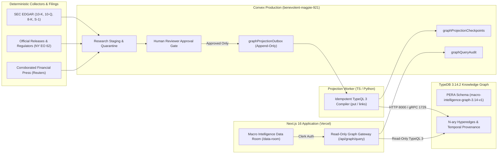

# AI Capital Intelligence — Phase G.1: TypeDB 3 Macro Intelligence Graph Architecture

## 1. Purpose & Architectural Role

TypeDB 3 (`3.14.2`) serves as the **Relationship-Intelligence Engine** for AI Capital Intelligence (`https://capital.aiguides.co.uk`), extending — **never replacing** — Convex Production (`benevolent-magpie-921`) and Clerk Production (`ins_3LmpoQvdoIwHQTiSi7QsZu1cKRt`).

| Layer | System of Record / Runtime | Responsibility | Execution Authority |
|---|---|---|---|
| **Authentication & Identity** | Clerk Production (`clerk.capital.aiguides.co.uk`) | Browser session management, OIDC / JWT issuance (`azp`, `aud`, `iss` verified) | `none` |
| **Operational & Evidence Ledger** | Convex Production (`benevolent-magpie-921`) | Immutable research staging, human reviewer queue, append-only `graphProjectionOutbox`, `graphProjectionCheckpoints`, `graphQueryAudit`, and isolated brokerage vault | `none` (Live & Demo trading disabled) |
| **Typed Financial Knowledge Graph** | TypeDB 3.14 (`3.14.2`) | Polymorphic Entity-Relation-Attribute (PERA) hypergraph for N-ary financing, lease guarantees, GPU supply chains, power grid dependencies, temporal point-in-time reconstruction, and supersession lineage | `none` |
| **Application & Query Gateway** | Next.js 16 (`app/api/graph/query/route.ts`, `/data-room`) | Read-only allowlisted query gateway, rate limiting, tenant isolation, bounded TL;DR synthesis, and the 5-view Macro Intelligence Data Room | `none` |

---

## 2. TypeDB 3 Platform Research & Pinned Compatibility Matrix

All implementation artifacts strictly target **TypeDB 3.x** (`https://typedb.com/docs/`) and eliminate legacy TypeDB 2.x syntax (`define` rule blocks, `$rel (role: $x) isa ...` without `links`, or `session`-based transaction life cycles).

### 2.1 Version-Pinned Components

| Component | Pinned Version | Protocol & Default Port | Verification Status |
|---|---|---|---|
| **TypeDB Community Edition Server** | `3.14.2` (`typedb-all-windows-x86_64-3.14.2` / Docker `typedb/typedb:3.14.2`) | gRPC `127.0.0.1:1729` · HTTP `127.0.0.1:8000` | Verified live (`schema`, `write`, `read` transactions) |
| **TypeScript HTTP Driver** | `@typedb/driver-http@3.14.0` (`--save-exact` in `package.json`) | HTTP/JSON (`POST /v1/signin`, `/v1/transactions/open`, `/v1/transactions/:id/query`, `/v1/transactions/:id/commit`) | Verified live in Vitest (`tests/typedb-graph.test.ts`) |
| **Python gRPC Driver** | `typedb-driver==3.14.0` | gRPC (`127.0.0.1:1729`) using `TypeDB.driver(address, Credentials, DriverOptions(DriverTlsConfig))` | Verified live in Python (`worker/test_graph_projection.py`) |
| **TypeQL Schema Version** | `macro-intelligence-graph-3.14-v1` | TypeQL 3 PERA (`@abstract`, `@key`, `@unique`, `@card(...)`, `links (...)`) | Verified live (`10,323` bytes schema readback) |

### 2.2 Key TypeDB 3.14 Architectural Findings & Deployment Limitations

1. **Sessionless Transaction Architecture (TypeDB 3 vs 2.x)**:
   - TypeDB 3 removes the 2.x `Session` layer. Transactions (`TransactionType.SCHEMA`, `TransactionType.WRITE`, `TransactionType.READ`) are opened directly against a database with isolated snapshot semantics and configurable transaction timeouts.
2. **Dual Native Endpoints (`1729` gRPC vs `8000` HTTP)**:
   - TypeDB 3.14 exposes gRPC on port `1729` for high-throughput background workers (`typedb-driver==3.14.0`) and a native HTTP API on port `8000` (`@typedb/driver-http@3.14.0`), which allows Next.js serverless routes on Vercel to query TypeDB over HTTPS without native Rust/C++ gRPC binary dependencies.
3. **Strict TypeQL 3 PERA Syntax Rules**:
   - Abstract super-relations that do not declare their own `relates` role must carry `@abstract` (`relation macro_relationship @abstract`), or TypeDB 3.14 rejects schema commit with `[SVL41]`.
   - Role player bindings on named relation variables require the explicit `links` keyword (`$rel isa financing_arrangement, links (financier: $p0, borrower: $p1, target_project: $p2)`).
4. **Community Edition vs TypeDB Cloud Limitations**:
   - **TypeDB Community Edition (CE)** runs as a single-node binary or Docker container (`typedb/typedb:3.14.2`). In CE, gRPC encryption is disabled by default unless wrapped behind a TLS termination proxy (Caddy/Nginx/Cloudflare Tunnel/tailnet) or mTLS ingress; backups are performed via database export (`typedb console` / volume snapshots) plus deterministic replay from Convex's append-only `graphProjectionOutbox`.
   - **TypeDB Cloud** provides managed multi-node HA clustering, automated encrypted TLS (`DriverTlsConfig.enabled_with_native_root_ca()`), automated point-in-time backups, and RBAC user management.

---

## 3. System Topology & Data Flow

---

## 4. Hosting, Operational & Cost Assessment

| Deployment Option | Infrastructure Specification | Monthly Infrastructure Cost (USD) | Ingestion & Query Model Cost | Security & Backup Posture |
|---|---|---|---|---|
| **Local / Private Loopback TypeDB CE (`3.14.2`)** | Single-node `typedb_server_bin` / Docker bound to `127.0.0.1:1729` & `127.0.0.1:8000` | **$0 / mo** | **$0.00** (Deterministic compiler & bounded TL;DR — zero LLM token burn) | Loopback-only (`127.0.0.1`); full rebuild in `< 5s` via Convex outbox replay |
| **Self-Hosted TypeDB CE on Private VPS / Fly.io / Railway** | 2 vCPU, 4 GB RAM, 20 GB NVMe + internal WireGuard / mutual-TLS reverse proxy | **$18 – $28 / mo** | **$0.00** | Private network / mTLS; daily volume snapshot + Convex outbox replay |
| **Managed TypeDB Cloud (Dedicated Starter Cluster)** | Managed single/multi-node TypeDB 3.14 with native TLS & automated snapshots | **$95 – $180 / mo** | **$0.00** | Native TLS (`DriverTlsConfig.enabled_with_native_root_ca()`), managed backups |

### Recommendation
- **Development & CI Verification**: Run pinned TypeDB CE `3.14.2` bound to `127.0.0.1:1729` (gRPC) and `127.0.0.1:8000` (HTTP), verified automatically by `tests/typedb-graph.test.ts` and `worker/test_graph_projection.py`.
- **Production Vercel Integration**: Point `TYPEDB_HTTP_URL` on Vercel to a TLS-terminated TypeDB 3.14 endpoint (or rely on the deterministic mirror fallback when the remote TypeDB cluster is hibernated), while Convex (`graphProjectionOutbox`) remains the immutable durability source of truth capable of re-projecting the entire graph from sequence `0` at any time.
