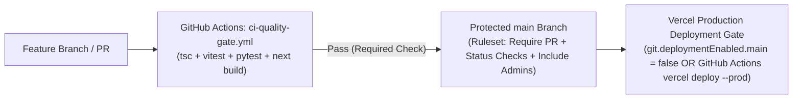

# 11 — Independent Due Diligence Remediation Plan & Revised Authorisation Scope

**Programme:** Vectis ONE / AI Capital Intelligence — Independent Due Diligence Remediation Programme  
**Document ID:** `DOC-DD-REMEDIATION-PLAN-20261110-REV2`  
**Date:** 10 November 2026  
**Baseline Commit:** [`639a2ed`](https://github.com/Davg883/Trading-App/commit/639a2ed) (`main`)  
**Execution Posture:** Read-only audit complete; revised stage boundaries incorporated. **No implementation, deployment, repository visibility change, or credential change will begin until the owner completes credential revocation and provides explicit authorisation.**

---

## 1. Immediate Owner Action — Exposed GitHub OAuth Token Revocation (`D14 / E-35`)

### 1.1 Incident Summary
During the GitHub Actions investigation on 10 November 2026 (`15:53 UTC`), `"protocol=https\nhost=github.com" | git credential fill` was executed in PowerShell, printing the owner's GitHub OAuth token (`gho_…`, scopes `gist, repo, workflow`) into the local tool transcript.
- **Git Repository Check:** The token was **never** written to any tracked or untracked repository file and does not appear in Git commit history.
- **Risk:** Because the token holds `repo` and `workflow` write authority on `Davg883/Trading-App`, it must be treated as compromised and revoked by the owner before any implementation stage begins.

### 1.2 Authorised Owner Revocation & Re-Authentication Procedure (Owner Action Only)
1. **Revoke the OAuth Token on GitHub:**
   - Open **GitHub Settings → Applications → Authorized OAuth Apps** ([https://github.com/settings/applications](https://github.com/settings/applications)) and locate **Git Credential Manager** (or **GitHub CLI**), *or* open **Settings → Developer settings → Personal access tokens** ([https://github.com/settings/tokens](https://github.com/settings/tokens)).
   - Click **Revoke** (or **Revoke all user tokens**) for the grant issued prior to `10 Nov 2026 16:00 UTC`.
   - Inspect **GitHub Settings → Security log** ([https://github.com/settings/security-log](https://github.com/settings/security-log)) for any unexpected push or workflow activity.
2. **Purge the Local Windows Credential Manager Entry (Outside Agent Logs):**
   ```powershell
   cmdkey /delete:LegacyGeneric:target=git:https://github.com
   cmdkey /delete:git:https://github.com
   gh auth logout --hostname github.com
   ```
3. **Re-Authenticate Cleanly Outside Agent Sessions:**
   - Run `gh auth login --hostname github.com --git-protocol https --web` or create a **Fine-Grained Personal Access Token** scoped strictly to `Davg883/Trading-App` (`Contents: Read and write`, `Workflows: Read and write`).

---

## 2. Stage 1A — Urgent Convex Privacy & Access-Control Remediation (Isolated First Change)

In accordance with the revised authorisation scope, **Stage 1A addresses only the urgent Convex privacy and access-control findings** as a small, self-contained, independently reviewable change.

### 2.1 Exhaustive Audit of All 19 Convex Functional Modules

Every `.ts` file in [`convex/`](file:///c:/GPT%205%20CODEX/Trading%20app/convex) was audited for:
- Unauthenticated `process.env.RESEARCH_OWNER_ID` or hard-coded owner fallbacks;
- Unscoped `ctx.db.query(...)` scans lacking `.withIndex('by_owner', ...)` (or `.withIndex('by_subject', ...)`), which could substitute another user's records;
- Public mutations or actions lacking authentication, authorisation, replay protection, CSPRNG randomness, or caller restrictions.

#### Complete Findings Across `convex/`

| Defect ID | File & Lines | Function & Type | Exact Vulnerability Found | Stage 1A Remediation |
| :--- | :--- | :--- | :--- | :--- |
| **1A-1** | [`convex/operations.ts:685-691`](file:///c:/GPT%205%20CODEX/Trading%20app/convex/operations.ts#L685-L691) | `publicOperationsOverview` (`query` — public) | Falls back to `const owner = identity?.tokenIdentifier ?? process.env.RESEARCH_OWNER_ID;` when unauthenticated, and does not call `verifyIdentityClaims(identity)` when authenticated. | Remove `process.env.RESEARCH_OWNER_ID` fallback completely. When unauthenticated (`!rawIdentity`), return an explicitly designed, strictly non-sensitive `buildPublicOperationsStatus(now)` response with **zero database queries** against private owner tables. When authenticated, verify claims via `researcher(ctx)` and scope strictly to `user.tokenIdentifier`. |
| **1A-2** | [`convex/operations.ts:229-241`](file:///c:/GPT%205%20CODEX/Trading%20app/convex/operations.ts#L229-L241) | `buildOperationsOverview` (helper called by `overview`, `publicOperationsOverview`, `getOperationsOverviewInternal`) | When `owner === process.env.RESEARCH_OWNER_ID` and `ownerBrokerConn` is null or `ownerChatAuditRows` is empty, executes unscoped table scans: `ctx.db.query('brokerConnections').order('desc').first()` and `ctx.db.query('evidenceChatAudit').order('desc').take(200)`. If a second user exists, the owner's dashboard or public overview substitutes the second user's records. | Delete both unscoped fallback scans. Query `brokerConnections` and `evidenceChatAudit` strictly via `.withIndex('by_owner', q => q.eq('owner', owner))`. Also redact static internal infrastructure identifiers (`harmless-akita-9211`, `benevolent-magpie-921`, `teoxx0-0.cluster.typedb.com:80`) in `environmentAudit`. |
| **1A-3** | [`convex/evidenceChat.ts:353-424`](file:///c:/GPT%205%20CODEX/Trading%20app/convex/evidenceChat.ts#L353-L424) | `getChatOperationsTelemetry` (`query` — public) | 1. Falls back to `process.env.RESEARCH_OWNER_ID` when unauthenticated.<br>2. Does not call `verifyIdentityClaims(rawIdentity)`.<br>3. Line 368 executes an unscoped scan `ctx.db.query('evidenceChatAudit').order('desc').take(50)` when `ownerTurns.length === 0 && rawIdentity === null`. | Require authenticated human researcher via `const user = await researcher(ctx); const owner = user.tokenIdentifier;`. Delete the `process.env.RESEARCH_OWNER_ID` fallback and delete the line 368 unscoped table scan. |
| **1A-4** | [`convex/evidenceChat.ts:557-577`](file:///c:/GPT%205%20CODEX/Trading%20app/convex/evidenceChat.ts#L557-L577) | `mintServerAcceptanceTokenInternal` (`internalMutation`) | 1. Uses non-cryptographic `Math.random()` (`Math.floor(Math.random() * 0xffffffff)`) to generate security-sensitive acceptance nonces.<br>2. Falls back to synthetic owner `'system_acceptance'` if `RESEARCH_OWNER_ID` is unset. | Replace `Math.random()` with Web Crypto CSPRNG (`crypto.getRandomValues(new Uint8Array(32))` encoded as 64-char hex). Require explicit `owner` argument or configured `process.env.RESEARCH_OWNER_ID` (throw if missing; remove `'system_acceptance'` fallback). |
| **1A-5** | [`convex/evidenceChat.ts:579-734`](file:///c:/GPT%205%20CODEX/Trading%20app/convex/evidenceChat.ts#L579-L734) & [`app/api/graph/chat/route.ts:140-160,302-311`](file:///c:/GPT%205%20CODEX/Trading%20app/app/api/graph/chat/route.ts#L140-L160) | `consumeAcceptanceNonceAndGetContext` & `recordAcceptanceChatTurn` (`mutation` — public) | 1. Both are **public** `mutation`s callable by any anonymous party on the internet without Clerk auth.<br>2. Two-phase state (`issued` → `consumed` → `recorded`) leaves a race window during Gemini inference where an attacker who observes or guesses a nonce can call `recordAcceptanceChatTurn` directly with arbitrary fabricated `estimatedCostGbp` (exhausting the owner's daily cost budget) or poisoned `evidenceChatAudit` payloads.<br>3. Uses shallow `.take(40)` scan on shared `audit` table and non-constant-time string match.<br>4. Falls back to `'system_acceptance'`. | Convert both `consumeAcceptanceNonceAndGetContext` and `recordAcceptanceChatTurn` from public `mutation` to `internalMutation` (callable only by Convex internal runtime / deployment admin, never via public `ConvexHttpClient`). Remove the unauthenticated `x-aci-acceptance-nonce` public mutation path from `app/api/graph/chat/route.ts`. Add strict finite/non-negative bounds validation on token counts, latency, and cost fields in `recordEvidenceChatTurn` and `recordAcceptanceChatTurn`. |
| **1A-6** | [`convex/graph.ts:820-822,1162-1165`](file:///c:/GPT%205%20CODEX/Trading%20app/convex/graph.ts#L1162-L1165) | `syncAndVerifyTypeDbCloud` & `reconcileAndVerifyProductionIsolationCloud` (`internalAction`) | Falls back to hard-coded strings `'https://clerk.capital.aiguides.co.uk\|owner_bootstrap'` (line 822) and `'https://harmless-akita-9211.clerk.accounts.dev\|user_3LjSsuJX398YIJRdss5Q7PqsSH9'` (line 1165). | Remove both hard-coded fallback literals. Require `args.owner ?? process.env.RESEARCH_OWNER_ID` and throw an explicit error if neither is set. |
| **1A-7** | [`convex/graph.ts:1002-1090`](file:///c:/GPT%205%20CODEX/Trading%20app/convex/graph.ts#L1002-L1090) | `projectPendingOutboxNow`, `probeHostedTypeDbCloud`, `verifyHostedTypeDbCloud` (`action` — public) | 1. `projectPendingOutboxNow` checks `ctx.auth.getUserIdentity()` without calling `verifyIdentityClaims(identity)` or rejecting non-human `actorType`.<br>2. `probeHostedTypeDbCloud` and `verifyHostedTypeDbCloud` return raw internal TypeDB cluster address (`httpAddress`) in public responses. | Call `verifyIdentityClaims(identity)` and reject automated actors in `projectPendingOutboxNow`. Omit/redact raw `httpAddress` from public `probeHostedTypeDbCloud` and `verifyHostedTypeDbCloud` responses. |

---

### 2.2 Deep Audit of `consumeAcceptanceNonceAndGetContext`, `recordAcceptanceChatTurn`, and `mintServerAcceptanceTokenInternal`

1. **Authentication & Caller Restrictions:**
   - Currently, `consumeAcceptanceNonceAndGetContext` and `recordAcceptanceChatTurn` are exported via `mutation({...})` (public). Any external client with `NEXT_PUBLIC_CONVEX_URL` can invoke them without a Clerk JWT (`ctx.auth.getUserIdentity()` is never inspected).
   - Converting both to `internalMutation({...})` restricts invocation strictly to Convex internal actions (`ctx.runMutation`) or deployment-admin CLI/server credentials (`CONVEX_DEPLOY_KEY`). External HTTP/WebSocket clients receive an immediate Convex error (`Could not find public function`).
2. **Cryptographic Randomness (`mintServerAcceptanceTokenInternal`):**
   - Currently uses `Math.floor(Math.random() * 0xffffffff).toString(16).padStart(8, '0')` (V8 `xorshift128+`, non-cryptographic).
   - Replaced with 256 bits of CSPRNG entropy via Web Crypto API:
     ```ts
     const bytes = new Uint8Array(32);
     crypto.getRandomValues(bytes);
     const randomHex = Array.from(bytes, (b) => b.toString(16).padStart(2, '0')).join('');
     const nonce = `aci-accept-${now}-${randomHex}`;
     ```
3. **Replay Protection & State-Transition Integrity:**
   - Nonce format is validated (`/^aci-accept-\d{13}-[0-9a-f]{64}$/`) before any database read.
   - Constant-time byte comparison (`constantTimeEqual`) is used when matching `a.recordId` against `args.nonce`.
   - `detail === 'issued'` can transition to `'consumed'` at most once within Convex's serializable ACID mutation transaction (`now - a.at <= 120_000 && now >= a.at`), and `'consumed'` can transition to `'recorded'` at most once. Any second replay attempt fails closed.
4. **Input Validation on Audit Turn Recording (`recordEvidenceChatTurn` & `recordAcceptanceChatTurn`):**
   - Validate that `inputTokens`, `outputTokens`, `cachedTokens`, and `latencyMs` are non-negative safe integers (`>= 0`, `<= 10_000_000`), `estimatedCostGbp` and `actualCostGbp` are finite non-negative numbers (`>= 0`, `<= 100`), `question` is 3–1,000 chars, and `bundleJson`/`answerJson`/`validationJson` are bounded (`<= 256_000` chars).

---

### 2.3 Before / After Access-Control Matrix Across Convex

| Module & Function | Kind | Before Stage 1A | After Stage 1A |
| :--- | :--- | :--- | :--- |
| **`operations:overview`** | Public `query` | `researcher(ctx)` (`signedIn` + human check), **but** if `owner === RESEARCH_OWNER_ID` and `brokerConnections` or `evidenceChatAudit` is empty, scans across all users' rows (`lines 232, 241`). | `researcher(ctx)` + strict `.withIndex('by_owner', q => q.eq('owner', owner))` only. Empty owner dataset returns `null` / `[]`, never scanning other users. |
| **`operations:publicOperationsOverview`** | Public `query` | Unauthenticated callers fall back to `process.env.RESEARCH_OWNER_ID` and read owner's private `brokerConnections` status, `evidenceChatAudit` telemetry, `operationsSettings` ceilings/spend, `researchJobRuns`, and `researchStagingItems`. | **No fallback to `RESEARCH_OWNER_ID`.** Unauthenticated callers receive only static/public `PublicOperationsStatus` (`authenticated: false`, zero private DB reads). Authenticated callers verified via `researcher(ctx)` read only their own `user.tokenIdentifier` partition. |
| **`operations:configureSettings`, `setJobEnabled`, `registerForwardStudy`** | Public `mutation` | `researcher(ctx)`, scoped to `user.tokenIdentifier`. | Unchanged (`researcher(ctx)`, scoped to `user.tokenIdentifier`). |
| **`operations:*Internal` (6 functions)** | `internalQuery` / `internalMutation` | Internal only; requires `owner: v.string()` verified by `validOwner`. | Unchanged (internal only; unscoped scans in `buildOperationsOverview` removed). |
| **`evidenceChat:getChatOperationsTelemetry`** | Public `query` | Unauthenticated callers fall back to `RESEARCH_OWNER_ID`, and if empty, scan `ctx.db.query('evidenceChatAudit').order('desc').take(50)` across all users. | **Requires `researcher(ctx)`.** Unauthenticated callers are rejected (`Sign in required`). Queries strictly `.withIndex('by_owner', q => q.eq('owner', user.tokenIdentifier))`. |
| **`evidenceChat:listChatHistory`, `getEvidenceBundleById`, `getChatRetrievalContext`** | Public `query` | `researcher(ctx)`, scoped strictly to `user.tokenIdentifier`. | Unchanged (`researcher(ctx)`, scoped strictly to `user.tokenIdentifier`). |
| **`evidenceChat:recordEvidenceChatTurn`** | Public `mutation` | `researcher(ctx)`, scoped to `user.tokenIdentifier`, but no numeric/size bounds on cost/tokens/JSON. | `researcher(ctx)` + strict bounds validation (`assertValidChatTurnFields`) preventing negative/infinite cost or oversized payloads. |
| **`evidenceChat:askEvidenceLockedQuestion`** | Public `action` | `verifyIdentityClaims(rawIdentity)` + human actor check, scoped to `identity.tokenIdentifier`. | Unchanged (`verifyIdentityClaims` + human check, scoped to `identity.tokenIdentifier`). |
| **`evidenceChat:mintServerAcceptanceTokenInternal`** | `internalMutation` | Internal only, but uses `Math.random()` and falls back to `'system_acceptance'`. | Internal only; uses 256-bit `crypto.getRandomValues` CSPRNG and requires explicit `owner` or `RESEARCH_OWNER_ID` (no `'system_acceptance'` fallback). |
| **`evidenceChat:consumeAcceptanceNonceAndGetContext`** | Public `mutation` → **`internalMutation`** | **Public `mutation`** callable without Clerk auth; falls back to `'system_acceptance'`. | **`internalMutation`** (inaccessible from public clients); requires `RESEARCH_OWNER_ID`; validates nonce format and constant-time match. |
| **`evidenceChat:recordAcceptanceChatTurn`** | Public `mutation` → **`internalMutation`** | **Public `mutation`** callable without Clerk auth; vulnerable to mid-flight hijack/cost-poisoning; falls back to `'system_acceptance'`. | **`internalMutation`** (inaccessible from public clients); requires `RESEARCH_OWNER_ID`; enforces `assertValidChatTurnFields` and constant-time match. |
| **`graph:enqueueApprovedRelationship`, `reviewAndPromoteRelationship`, `replayFromCheckpoint`** | Public `mutation` | `reviewer(ctx)`, scoped to `rev.tokenIdentifier`. | Unchanged (`reviewer(ctx)`, scoped to `rev.tokenIdentifier`). |
| **`graph:recordProjectionOutcome`, `projectionHealth`, `recordGraphQueryAudit`** | Public `mutation` / `query` | `signedIn(ctx)`, scoped to `user.tokenIdentifier`. | Unchanged (`signedIn(ctx)`, scoped to `user.tokenIdentifier`). |
| **`graph:projectPendingOutboxNow`** | Public `action` | Checks `ctx.auth.getUserIdentity()` without `verifyIdentityClaims` or human actor check. | Enforces `verifyIdentityClaims(identity)` and human actor check (`actorType === 'human'`). |
| **`graph:syncAndVerifyTypeDbCloud`, `reconcileAndVerifyProductionIsolationCloud`** | `internalAction` | Falls back to `'owner_bootstrap'` or hard-coded `user_3LjSsu...`. | Hard-coded fallback literals removed; requires `args.owner ?? process.env.RESEARCH_OWNER_ID`. |
| **`brokers:*`, `portfolio:overview`, `trading:*`, `roles:*`, `research:*`, `earnings:*`, `stress:*`, `infrastructure:*`, `defence:*`, `consensus:*`, `policyRisk:*`, `recovery:*`, `proofScale:*`** | Public `query` / `mutation` & `internal*` | All public functions enforce `signedIn(ctx)`, `researcher(ctx)`, `reviewer(ctx)`, or `administrator(ctx)` and scope strictly by `user.tokenIdentifier`. | Unchanged (verified clean in exhaustive audit). |

---

### 2.4 Historical Data Exposure & Forensic Log Assessment

#### 1. Identification of Historical Data Exposure
While `operations:publicOperationsOverview` and `evidenceChat:getChatOperationsTelemetry` were deployed on production Convex (`benevolent-magpie-921.eu-west-1.convex.cloud`) with `NEXT_PUBLIC_CONVEX_URL` published in the public web bundle and public GitHub repository:
- **What WAS exposed to unauthenticated callers:**
  1. **Owner Broker Connection Metadata (`publicOperationsOverview`):** Whether the owner's Trading 212 read-only connection status was `connected`, `degraded`, or `unavailable`, and the timestamp `lastSuccessfulSyncAt`.
  2. **Owner Aggregate Chat Telemetry (`publicOperationsOverview` & `getChatOperationsTelemetry`):** Total chat turns recorded, turns today, supported/partially supported/unsupported counts, validation rejection count, provider error count, aggregate input/output token counts, estimated daily/total GBP model spend, daily cost ceiling (`£2.00`), active model ID (`gemini-2.5-flash`), and `lastChatAtMs`.
  3. **Owner Research Collector Activity (`publicOperationsOverview`):** Up to 25 recent `researchJobRuns` metadata rows, up to 15 staged SEC/news items (`researchStagingItems`), the latest daily intelligence briefing (`morningBriefings`), stored public market observations (`marketObservations`), and forward study registrations (`forwardResearchEvents`).
  4. **Infrastructure Identifiers:** Clerk instance domain (`harmless-akita-9211`), Convex deployment slug (`benevolent-magpie-921`), TypeDB Cloud cluster hostname (`teoxx0-0.cluster.typedb.com:80`), and the Clerk user ID literal in `convex/graph.ts:1165`.
- **What was NOT exposed:**
  - **Zero Trading 212 API keys, secret keys, or AES-256-GCM ciphertexts** (`brokerCredentials` and `tradingCredentials` are queried only inside `internalQuery` functions and never returned by `buildOperationsOverview`).
  - **Zero portfolio holdings, instrument quantities, cash balances, or valuation histories** (`portfolio:overview` and `brokers:detail` always enforced `researcher(ctx)` / `signedIn(ctx)`).
  - **Zero raw chat questions, answers, or evidence bundles** (`question`, `answerJson`, and `bundleJson` are omitted by both `getChatOperationsTelemetry` and `buildOperationsOverview`; `listChatHistory` and `getEvidenceBundleById` always enforced `researcher(ctx)`).

#### 2. Assessment of Whether Existing Access Logs Can Establish Unauthorised Access
- **Read-Only Queries (`publicOperationsOverview`, `getChatOperationsTelemetry`):**
  - **Existing logs CANNOT prove or rule out unauthorised third-party read access.**
  - *Technical Reason 1 (Convex Read Transaction Semantics):* Convex `query` functions are deterministic read-only transactions that cannot insert rows into the `audit` table, and Convex Cloud does not maintain a permanent, queryable historical IP access log for read queries.
  - *Technical Reason 2 (Server-Side SSR Aggregation):* Every anonymous HTTP request (including crawlers and bots) to `https://capital.aiguides.co.uk/` or `/workspace` caused Next.js Server Components on Vercel to call `fetchLiveOperationsOverview()` → `operations:publicOperationsOverview` from Vercel serverless egress IPs without forwarding visitor IP or identity headers to Convex.
  - Therefore, from a conservative due diligence standpoint, all fields returned by `publicOperationsOverview` and `getChatOperationsTelemetry` prior to Stage 1A deployment must be classified as **historically publicly disclosed**.
- **Public Mutations (`consumeAcceptanceNonceAndGetContext`, `recordAcceptanceChatTurn`):**
  - **Existing logs CAN deterministically establish whether unauthorised mutation execution occurred.**
  - Every execution of `mintServerAcceptanceTokenInternal`, `consumeAcceptanceNonceAndGetContext`, and `recordAcceptanceChatTurn` mutates or inserts a row in the immutable Convex `audit` table (`action: 'graph.evidence_chat.acceptance_nonce'` and `action: 'graph.evidence_chat.turn'`). Inspecting `audit` rows in Convex confirms whether any acceptance nonce was ever minted or consumed outside known owner verification timestamps.

#### 3. Remaining Privacy Risks After Stage 1A (and How Subsequent Stages Close Them)
1. **Historical Git Commit History (`Stage 0`):** Even after `convex/graph.ts:1165` is cleaned in Stage 1A, the historical Clerk `user_...` literal remains in prior Git commits until the repository is switched from **Public** to **Private** in GitHub Settings (`Stage 0`).
2. **Single-Key Application Vault (`Architectural — Phase B`):** `BROKER_VAULT_KEY_B64` encrypts broker credentials at the application layer with `owner` bound in AES-GCM AAD (`v1:${owner}:${environment}:${revision}`). While cross-user decryption is cryptographically blocked by AAD verification, a future multi-tenant platform requires per-tenant KMS envelope keys.
3. **Server-Side Plaintext Inspection During Active Sync:** During the brief execution of `POST /api/brokers` (`action: 'sync'`), the Next.js server decrypts the Trading 212 read-only key in memory to call Trading 212 and stores the resulting positions JSON in `brokerSnapshots`. Rows in `brokerSnapshots` are owner-isolated in Convex (`researcher(ctx)`) and never returned by public queries, but are readable by a deployment administrator holding `CONVEX_DEPLOY_KEY`.

---

### 2.5 Exact Proposed Code Diff for Stage 1A

Stage 1A modifies **only 5 files** (`convex/operations.ts`, `convex/evidenceChat.ts`, `convex/graph.ts`, `lib/remote-ops/server.ts`, `app/api/graph/chat/route.ts`) and adds **1 dedicated multi-user negative test suite** (`tests/remediation-stage-1a-convex-access-control.test.ts`):

#### Diff 1: [`convex/operations.ts`](file:///c:/GPT%205%20CODEX/Trading%20app/convex/operations.ts)
```diff
@@ -225,21 +225,13 @@ async function buildOperationsOverview(ctx:Ctx,owner:string,now:number){
- const ownerBrokerConn=await ctx.db
+ const brokerConn=await ctx.db
   .query('brokerConnections')
   .withIndex('by_owner',q=>q.eq('owner',owner))
   .first();
- const brokerConn=
-  ownerBrokerConn||owner!==process.env.RESEARCH_OWNER_ID
-   ?ownerBrokerConn
-   :await ctx.db.query('brokerConnections').order('desc').first();
- const ownerChatAuditRows=await ctx.db
+ const chatAuditRows=await ctx.db
   .query('evidenceChatAudit')
   .withIndex('by_owner',q=>q.eq('owner',owner))
   .order('desc')
   .take(200);
- const chatAuditRows=
-  ownerChatAuditRows.length>0||owner!==process.env.RESEARCH_OWNER_ID
-   ?ownerChatAuditRows
-   :await ctx.db.query('evidenceChatAudit').order('desc').take(200);
@@ -684,8 +676,12 @@ export const overview=query({args:{},handler:async ctx=>{
-/** Public zero-argument read-only overview for hydrating research operations status without a deploy key (contains zero broker/account PII). */
+/**
+ * Explicitly scoped operational status query:
+ * - When called by an authenticated human researcher, returns their owner-scoped operations overview.
+ * - When called anonymously, executes ZERO private owner queries (never falling back to RESEARCH_OWNER_ID)
+ *   and returns only the non-sensitive public operational schema (`buildPublicOperationsStatus`).
+ */
 export const publicOperationsOverview=query({args:{},handler:async ctx=>{
  const identity=await ctx.auth.getUserIdentity();
- const owner=identity?.tokenIdentifier??process.env.RESEARCH_OWNER_ID;
- if(!owner)return null;
- validOwner(owner);
- return await buildOperationsOverview(ctx,owner,Date.now());
+ if(!identity)return buildPublicOperationsStatus(Date.now());
+ const user=await researcher(ctx);
+ return await buildOperationsOverview(ctx,user.tokenIdentifier,Date.now());
 }});
```

#### Diff 2: [`convex/evidenceChat.ts`](file:///c:/GPT%205%20CODEX/Trading%20app/convex/evidenceChat.ts)
```diff
@@ -35,6 +35,34 @@ function validOwner(owner: string) {
   if (!owner.trim() || owner.length > 1000) throw new Error('Owner required');
 }
+
+function assertValidChatTurnFields(args: {
+  question: string;
+  inputTokens: number;
+  outputTokens: number;
+  cachedTokens: number;
+  estimatedCostGbp: number;
+  actualCostGbp: number | null;
+  latencyMs: number;
+  bundleJson: string;
+  answerJson: string;
+  validationJson: string;
+}) {
+  if (args.question.trim().length < 3 || args.question.length > 1000) {
+    throw new Error('Question must be between 3 and 1000 characters');
+  }
+  for (const n of [args.inputTokens, args.outputTokens, args.cachedTokens, args.latencyMs]) {
+    if (!Number.isSafeInteger(n) || n < 0 || n > 10_000_000) {
+      throw new Error('Token counts and latency must be non-negative safe integers');
+    }
+  }
+  if (!Number.isFinite(args.estimatedCostGbp) || args.estimatedCostGbp < 0 || args.estimatedCostGbp > 100) {
+    throw new Error('Estimated cost out of bounds');
+  }
+  if (args.actualCostGbp !== null && (!Number.isFinite(args.actualCostGbp) || args.actualCostGbp < 0 || args.actualCostGbp > 100)) {
+    throw new Error('Actual cost out of bounds');
+  }
+  if (args.bundleJson.length > 256_000 || args.answerJson.length > 256_000 || args.validationJson.length > 256_000) {
+    throw new Error('Serialized chat audit payload exceeds maximum size');
+  }
+}
+
+function constantTimeStringMatch(a: string, b: string): boolean {
+  const enc = new TextEncoder();
+  const bufA = enc.encode(a);
+  const bufB = enc.encode(b);
+  if (bufA.length !== bufB.length) return false;
+  let diff = 0;
+  for (let i = 0; i < bufA.length; i++) diff |= bufA[i]! ^ bufB[i]!;
+  return diff === 0;
+}
@@ -353,19 +381,13 @@ export const askEvidenceLockedQuestion = action({
 export const getChatOperationsTelemetry = query({
   args: {},
   handler: async (ctx) => {
-    const rawIdentity = await ctx.auth.getUserIdentity();
-    const owner = rawIdentity?.tokenIdentifier ?? process.env.RESEARCH_OWNER_ID;
-    if (!owner) return null;
-
-    const ownerTurns = await ctx.db
+    const user = await researcher(ctx);
+    const owner = user.tokenIdentifier;
+    const recentTurns = await ctx.db
       .query('evidenceChatAudit')
       .withIndex('by_owner', (q) => q.eq('owner', owner))
       .order('desc')
       .take(50);
-    const recentTurns =
-      ownerTurns.length > 0 || rawIdentity !== null
-        ? ownerTurns
-        : await ctx.db.query('evidenceChatAudit').order('desc').take(50);
@@ -534,6 +556,7 @@ export const recordEvidenceChatTurn = mutation({
   handler: async (ctx, args) => {
     const user = await researcher(ctx);
     const owner = user.tokenIdentifier;
+    assertValidChatTurnFields(args);
     const id = await ctx.db.insert('evidenceChatAudit', {
@@ -557,16 +580,17 @@ export const recordEvidenceChatTurn = mutation({
 export const mintServerAcceptanceTokenInternal = internalMutation({
-  args: {},
-  handler: async (ctx) => {
-    const owner = process.env.RESEARCH_OWNER_ID ?? 'system_acceptance';
+  args: { owner: v.optional(v.string()) },
+  handler: async (ctx, args) => {
+    const owner = args.owner ?? process.env.RESEARCH_OWNER_ID;
+    if (!owner) throw new Error('RESEARCH_OWNER_ID is required to mint an acceptance nonce');
+    validOwner(owner);
     const now = Date.now();
-    const randomPart = Array.from({ length: 4 }, () =>
-      Math.floor(Math.random() * 0xffffffff)
-        .toString(16)
-        .padStart(8, '0'),
-    ).join('');
-    const nonce = `aci-accept-${now}-${randomPart}`;
+    const bytes = new Uint8Array(32);
+    crypto.getRandomValues(bytes);
+    const randomHex = Array.from(bytes, (b) => b.toString(16).padStart(2, '0')).join('');
+    const nonce = `aci-accept-${now}-${randomHex}`;
@@ -579,8 +603,14 @@ export const mintServerAcceptanceTokenInternal = internalMutation({
-export const consumeAcceptanceNonceAndGetContext = mutation({
-  args: { nonce: v.string() },
+export const consumeAcceptanceNonceAndGetContext = internalMutation({
+  args: { nonce: v.string(), owner: v.optional(v.string()) },
   handler: async (ctx, args) => {
-    const owner = process.env.RESEARCH_OWNER_ID ?? 'system_acceptance';
+    const owner = args.owner ?? process.env.RESEARCH_OWNER_ID;
+    if (!owner) throw new Error('RESEARCH_OWNER_ID is required');
+    validOwner(owner);
+    if (!/^aci-accept-\d{13}-[0-9a-f]{64}$/.test(args.nonce)) {
+      return { valid: false as const };
+    }
@@ -591,7 +621,8 @@ export const consumeAcceptanceNonceAndGetContext = mutation({
         a.action === 'graph.evidence_chat.acceptance_nonce' &&
-        a.recordId === args.nonce &&
+        constantTimeStringMatch(a.recordId, args.nonce) &&
         a.detail === 'issued' &&
+        now >= a.at &&
         now - a.at <= 120_000,
     );
@@ -664,5 +695,6 @@ export const consumeAcceptanceNonceAndGetContext = mutation({
-export const recordAcceptanceChatTurn = mutation({
+export const recordAcceptanceChatTurn = internalMutation({
   args: {
     nonce: v.string(),
+    owner: v.optional(v.string()),
@@ -700,14 +732,20 @@ export const recordAcceptanceChatTurn = mutation({
   handler: async (ctx, args) => {
-    const owner = process.env.RESEARCH_OWNER_ID ?? 'system_acceptance';
+    const owner = args.owner ?? process.env.RESEARCH_OWNER_ID;
+    if (!owner) throw new Error('RESEARCH_OWNER_ID is required');
+    validOwner(owner);
+    if (!/^aci-accept-\d{13}-[0-9a-f]{64}$/.test(args.nonce)) {
+      throw new Error('Invalid or expired acceptance nonce');
+    }
+    assertValidChatTurnFields(args);
     const now = Date.now();
@@ -709,7 +747,8 @@ export const recordAcceptanceChatTurn = mutation({
         a.action === 'graph.evidence_chat.acceptance_nonce' &&
-        a.recordId === args.nonce &&
+        constantTimeStringMatch(a.recordId, args.nonce) &&
         a.detail === 'consumed' &&
+        now >= a.at &&
         now - a.at <= 120_000,
     );
```

#### Diff 3: [`convex/graph.ts`](file:///c:/GPT%205%20CODEX/Trading%20app/convex/graph.ts)
```diff
@@ -819,4 +819,4 @@ export const syncAndVerifyTypeDbCloud = internalAction({
-    const owner =
-      args.owner ??
-      process.env.RESEARCH_OWNER_ID ??
-      'https://clerk.capital.aiguides.co.uk|owner_bootstrap';
+    const owner = args.owner ?? process.env.RESEARCH_OWNER_ID;
+    if (!owner) {
+      throw new Error('RESEARCH_OWNER_ID or explicit owner argument is required');
+    }
@@ -1004,6 +1004,10 @@ export const projectPendingOutboxNow = action({
   handler: async (ctx) => {
-    const identity = await ctx.auth.getUserIdentity();
-    if (!identity) {
+    const rawIdentity = await ctx.auth.getUserIdentity();
+    if (!rawIdentity) {
       throw new Error('Authentication required');
     }
+    const identity = verifyIdentityClaims(rawIdentity);
+    if (identity.actorType !== undefined && identity.actorType !== 'human') {
+      throw new Error('Automated actors cannot trigger manual outbox projection');
+    }
@@ -1162,4 +1166,4 @@ export const reconcileAndVerifyProductionIsolationCloud = internalAction({
-    const owner =
-      args.owner ??
-      process.env.RESEARCH_OWNER_ID ??
-      'https://harmless-akita-9211.clerk.accounts.dev|user_3LjSsuJX398YIJRdss5Q7PqsSH9';
+    const owner = args.owner ?? process.env.RESEARCH_OWNER_ID;
+    if (!owner) {
+      throw new Error('RESEARCH_OWNER_ID or explicit owner argument is required');
+    }
```

#### Diff 4: [`convex/http.ts`](file:///c:/GPT%205%20CODEX/Trading%20app/convex/http.ts), [`lib/remote-ops/server.ts`](file:///c:/GPT%205%20CODEX/Trading%20app/lib/remote-ops/server.ts) & [`app/api/graph/chat/route.ts`](file:///c:/GPT%205%20CODEX/Trading%20app/app/api/graph/chat/route.ts)
- In [`convex/http.ts`](file:///c:/GPT%205%20CODEX/Trading%20app/convex/http.ts#L179-L300): expose `POST /api/chat/acceptance/consume`, `POST /api/chat/acceptance/record`, and `POST /api/chat/acceptance/fail`, authenticated exclusively by a dedicated `CHAT_ACCEPTANCE_GATEWAY_SECRET` (`>= 32` characters, verified in constant time via `constantTimeBearerMatch`), enforcing payload size limits (`16 KB` / `384 KB`) and `hasForbiddenKeys(body)` (blocking any client-supplied `owner`, `apiKey`, or `role` field).
- In [`lib/remote-ops/server.ts`](file:///c:/GPT%205%20CODEX/Trading%20app/lib/remote-ops/server.ts#L183-L227) (`fetchLiveOperationsOverview`): check `await auth()` from `@clerk/nextjs/server`; if the caller is signed in and holds a valid Convex token, call `c.setAuth(token)` so the signed-in owner receives their authenticated `publicOperationsOverview` telemetry while anonymous visitors receive the non-sensitive public operational status (`buildPublicOperationsStatus`) with zero private DB reads.
- In [`app/api/graph/chat/route.ts`](file:///c:/GPT%205%20CODEX/Trading%20app/app/api/graph/chat/route.ts#L188-L398): parse and validate the request body before touching any nonce; require either an authenticated Clerk session (`resolveAuthenticatedCaller(req)`) or a constant-time match on `x-aci-acceptance-gateway-secret` (`CHAT_ACCEPTANCE_GATEWAY_SECRET`); invoke `/api/chat/acceptance/consume` and `/api/chat/acceptance/record` over HTTPS; never read or trust `x-aci-acceptance-owner`; enforce distributed Convex rate limits (`retrievalCtx.rateLimited`); and invoke `/api/chat/acceptance/fail` (`state: 'failed_after_consume'`) if any post-consume error occurs.

### 2.9 Stage 1A Final Architecture Amendments (Resolved Locally)

1. **Dedicated Acceptance-Gateway Credential (`CHAT_ACCEPTANCE_GATEWAY_SECRET`):**
   - **Scope:** Authorises only the server-to-server HTTP Action gateway between Next.js (`app/api/graph/chat/route.ts`) and Convex (`convex/http.ts`: `/api/chat/acceptance/consume`, `/api/chat/acceptance/record`, `/api/chat/acceptance/fail`). Holds zero authority over `/api/operations/scheduled` (`OPERATIONS_SCHEDULER_SECRET`), `/api/research/staging` (`RESEARCH_STAGING_TOKEN`), broker vaults, or trading endpoints.
   - **Minimum Entropy & Rotation:** Minimum 32-character (256-bit) cryptographically random secret stored exclusively in Convex Cloud environment variables and Vercel server-only (`Production` / `Preview`) environment variables (never `NEXT_PUBLIC_*`). Rotation procedure: generate new 256-bit secret -> update Convex and Vercel -> redeploy Vercel serverless functions.
   - **Log Hygiene:** Never printed in `console.log`/`console.error`, never echoed in HTTP error bodies, and stripped from all Convex audit records (which store only `nonceId` UUID and state transitions).
2. **Owner & Server-State Authentication (Zero Trust in `x-aci-acceptance-owner`):**
   - Neither `app/api/graph/chat/route.ts` nor `convex/http.ts` reads or trusts `x-aci-acceptance-owner`.
   - Owner identity is established at mint time inside `chatAcceptanceNonces.owner` by `mintServerAcceptanceTokenInternal` and verified against `authenticatedOwner` (Clerk session) or `RESEARCH_OWNER_ID` inside `consumeAcceptanceNonceAndGetContext`. Any HTTP payload containing an `"owner"` property is rejected with HTTP `403 forbidden_capability`.
3. **Expand–Migrate–Contract Release Design & Controlled Security Containment:**
   - **State M0 (Pre-Release Preparation):** Configure `CHAT_ACCEPTANCE_GATEWAY_SECRET` (`>= 32` chars) in both Convex Cloud and Vercel Production environment variables.
   - **State M1 (Convex Deployment First — Immediate Exposure Containment):** Deploy `convex/schema.ts`, `convex/operations.ts`, `convex/evidenceChat.ts`, `convex/graph.ts`, and `convex/http.ts`.
     - *Immediate Security Effect:* Anonymous calls to `operations:publicOperationsOverview` immediately stop returning `RESEARCH_OWNER_ID` records (`authenticated: false`, zero private DB queries), and `evidenceChat:getChatOperationsTelemetry` immediately rejects anonymous callers (`Sign in required`).
     - *Backward Compatibility During State M1:* `/` and `/workspace` SSR (`fetchLiveOperationsOverview()`) and all ordinary Clerk-authenticated chat requests (`GET /api/graph/chat`, `POST /api/graph/chat` with Clerk session) continue to function without error across any variable deployment duration.
     - *Deliberate Temporary Unavailability During State M1:* Direct public mutation calls to `consumeAcceptanceNonceAndGetContext` and `recordAcceptanceChatTurn` are immediately blocked (`internalMutation`). Unauthenticated acceptance-nonce requests remain deliberately unavailable during `State M1` until the updated Next.js route is promoted in `State M2`.
   - **State M2 (Vercel Deployment Promotion):** Deploy `app/api/graph/chat/route.ts`, `lib/remote-ops/server.ts`, and `lib/graph/gemini-provider-adapter.ts`. Complete acceptance-token workflow resumes through `/api/chat/acceptance/*`.
   - **State R1 (Rollback Compatibility):** If the Vercel deployment in `State M2` is rolled back while Convex remains at `State M1`, owner privacy containment in Convex remains 100% intact, `/` and `/workspace` SSR remain operational (`authenticated: false`), and Clerk-authenticated chat remains operational; only CLI acceptance-nonce runs are blocked until `State M2` is re-promoted.
4. **Stage 1A Acceptance Checklist (`test-results/stage-1a-acceptance-artefact.json`):**
   - **Req 1 — Dedicated `CHAT_ACCEPTANCE_GATEWAY_SECRET` & rejection of `OPERATIONS_SCHEDULER_SECRET` / `RESEARCH_STAGING_TOKEN`:** `PASS` (Verified in `tests/remediation-stage-1a-convex-access-control.test.ts` Test 2).
   - **Req 2 — Zero trust in `x-aci-acceptance-owner` & server-state owner/question binding:** `PASS` (Verified in `tests/remediation-stage-1a-convex-access-control.test.ts` Tests 2 & 6).
   - **Req 3 & 4 — Expand–Migrate–Contract (`State M1` / `M2` / `R1`) & backward compatibility:** `PASS` (Verified in `tests/remediation-stage-1a-convex-access-control.test.ts` Tests 1 & 6).
   - **Req 5 — Concurrent nonce consumption (local `convex-test` + Multi-Snapshot OCC Conflict-and-Retry Simulator):** `PASS` locally (`1` winner, `9` `nonce_already_consumed` with `9` OCC conflict retries in `tests/remediation-stage-1a-convex-access-control.test.ts` Test 3); Live Convex Cloud network concurrency is **`NOT VERIFIED`** (blocked pending owner authorisation for production Convex deployment).
   - **Req 6 — Partial failure after nonce consumption (`failed_after_consume` transition & audit integrity):** `PASS` (Verified in `tests/remediation-stage-1a-convex-access-control.test.ts` Test 4).
   - **Req 7 — Single-instance (`checkGeminiChatRateLimit`) vs. distributed Convex (`evidenceChatAudit` `turnsLastMinute >= 10`) rate-limit enforcement:** `PASS` (Verified in `tests/remediation-stage-1a-convex-access-control.test.ts` Test 5).
   - **Req 8 — Independent E2E testing of acceptance-token workflow and ordinary Clerk-authenticated chat:** `PASS` (Verified in `tests/remediation-stage-1a-convex-access-control.test.ts` Test 6 and `tests/evidence-locked-chat.test.ts` Tests 1–12).
   - **Req 9 — Variable-duration deployment & rollback safety verification:** `PASS` locally; Live production rollout is **`NOT VERIFIED`** (awaiting owner authorisation).

---

## 3. Stage 2 — Research-Only Deployment (Separate Change & Commit)

### 3.1 Specification & Non-Override Guarantee
Stage 2 is prepared as an **independent change and commit** after Stage 1A/1B:
1. Define `export const RESEARCH_ONLY_DEPLOYMENT = true as const;` in [`lib/trading/server.ts`](file:///c:/GPT%205%20CODEX/Trading%20app/lib/trading/server.ts).
2. Change `executionFlag(environment)` in `lib/trading/server.ts` so that when `RESEARCH_ONLY_DEPLOYMENT === true`, it returns `false` unconditionally **even if `process.env.LIVE_TRADING_ENABLED === 'true'` and `process.env.DEMO_TRADING_ENABLED === 'true'` are set**.
3. At the entry of `handleTrading(request)` (`POST /api/trading`), before reading any environment flags or body parameters beyond `action`, block `save_trading_key`, `issue_confirmation`, `confirm`, `submit`, and `cancel` with HTTP `403`:
   ```json
   {
     "error": "research_only_deployment",
     "message": "Order execution and trading-capable key storage are architecturally disabled in this research-only deployment.",
     "executionAuthority": "none"
   }
   ```
4. Update [`app/trading/page.tsx`](file:///c:/GPT%205%20CODEX/Trading%20app/app/trading/page.tsx) to render a static Research-Only Deployment notice.

### 3.2 Stage 2 Acceptance Criteria (`tests/remediation-stage-2-research-only.test.ts`)
- Explicitly sets `process.env.LIVE_TRADING_ENABLED = 'true'` and `process.env.DEMO_TRADING_ENABLED = 'true'` inside the test harness and proves that:
  - `executionFlag('live')` and `executionFlag('demo')` still return `false`.
  - `POST /api/trading` with `action: 'save_trading_key'`, `'issue_confirmation'`, `'confirm'`, `'submit'`, and `'cancel'` all return HTTP `403` with `error: 'research_only_deployment'`.
  - Zero network calls to `live.trading212.com` or `demo.trading212.com` `/equity/orders` can be emitted.

---

## 4. Stage 3A — Baseline CI Quality Gate & Production Release Protection (Independent of Lint Clean-Up)

### 4.1 Baseline CI Quality Gate (`.github/workflows/ci-quality-gate.yml`)
To establish continuous integration immediately without waiting for the 18-file ESLint clean-up (`Stage 3B`), `Stage 3A` introduces `.github/workflows/ci-quality-gate.yml` on every `push` and `pull_request` to `main`:
1. **TypeScript Compiler Gate (`npm run typecheck` / `npx tsc --noEmit`)** — must exit `0` (0 type errors).
2. **Hermetic Unit & Integration Test Gate (`npm test`)** — runs Vitest (`tests/**`), using `describe.skipIf(!liveTypeDbAvailable)` only for the 2 tests that require an external TypeDB server on `127.0.0.1:8000` while running all 360+ deterministic and access-control tests.
3. **Python Worker Test Gate (`npm run test:python` / `pytest worker/tests`)** — runs all 219 Python tests.
4. **Next.js Production Build Gate (`npm run build`)** — verifies clean production compilation.
5. **Non-Regression ESLint Ratchet (`scripts/ci-eslint-ratchet.mjs`)** — runs `npx eslint . --format json` and fails the build if total errors exceed the current baseline (`31` errors / `21` warnings) or if any modified file introduces a new lint error, until `Stage 3B` reduces the ratchet ceiling to `0 errors, 0 warnings`.

### 4.2 How GitHub Required Checks and Vercel Deployment Settings Prevent Unverified Production Releases
Adding a `.github/workflows/ci-quality-gate.yml` file alone does **not** stop broken code from reaching production if:
1. A developer or agent pushes directly to `main` without branch protection; or
2. Vercel's GitHub integration builds and promotes every push to `main` in parallel with (and independently of) GitHub Actions.

To **genuinely prevent unverified production releases**, three platform controls must be configured together:



1. **GitHub Repository Ruleset on `refs/heads/main` (Owner Action in GitHub Settings → Rules → Rulesets):**
   - Enable **Require a pull request before merging** (blocks direct `git push origin main`).
   - Enable **Require status checks to pass before merging** and select `CI Quality Gate / verify` as a required check with **Require branches to be up to date before merging**.
   - Enable **Do not allow bypassing the above settings** (`include_administrators: true`), ensuring even repository administrators/owners cannot merge a PR when `ci-quality-gate.yml` is failing.
2. **Decoupling Vercel Production Promotion from Unchecked Git Pushes (Two Enforced Options):**
   - **Option 1 (Vercel Deployment Checks / GitHub Actions Promotion — Recommended):** In `vercel.json`, set:
     ```json
     {
       "git": {
         "deploymentEnabled": {
           "main": false
         }
       }
     }
     ```
     This disables Vercel's automatic parallel deployment on raw pushes to `main`. Instead, the final job of `.github/workflows/ci-quality-gate.yml` (`deploy-production`, with `needs: [verify]` and `if: github.ref == 'refs/heads/main' && github.event_name == 'push'`) executes `npx vercel pull --yes --environment=production && npx vercel build --prod && npx vercel deploy --prebuilt --prod` only **after** all typecheck, Vitest, pytest, and lint checks have passed.
   - **Option 2 (Vercel Deployment Protection — Checks Integration):** In **Vercel Dashboard → Project Settings → Git → Deployment Checks**, add `CI Quality Gate / verify` as a blocking check before Vercel promotes any build to the production alias (`capital.aiguides.co.uk`).

---

## 5. Stage 4 — Revised Live AI Evaluation & Telemetry Integrity Specification (`D1 / E-16`)

In accordance with the revised scope, Stage 4 enforces the following hard rules across [`lib/portfolio/portfolio-live-eval-5.ts`](file:///c:/GPT%205%20CODEX/Trading%20app/lib/portfolio/portfolio-live-eval-5.ts), [`lib/portfolio/portfolio-live-eval-15.ts`](file:///c:/GPT%205%20CODEX/Trading%20app/lib/portfolio/portfolio-live-eval-15.ts), [`lib/graph/chat-benchmark-50.ts`](file:///c:/GPT%205%20CODEX/Trading%20app/lib/graph/chat-benchmark-50.ts), and [`lib/research-ratings/thesis-monitor.ts`](file:///c:/GPT%205%20CODEX/Trading%20app/lib/research-ratings/thesis-monitor.ts):

1. **Zero Synthetic Provider Request IDs:**
   - Remove `'Tj3yaoqeGa6xuMYPoMuKoAk'` from `chat-benchmark-50.ts:905,966` and `thesis-monitor.ts:790`.
   - Remove `req-${Date.now()}` fallback in `portfolio-live-eval-5.ts:167` and `portfolio-live-eval-15.ts:305`. If `response.responseId` is missing or empty, `providerRequestId` is recorded as `null` and the turn is marked `telemetryVerified: false` and **cannot pass as a live evaluation**.
2. **Zero Invented Token Counts:**
   - Remove all fallback token literals (`620`, `165`, `520`, `140`, `650`, `180`, `550`, `150`).
   - If `response.usageMetadata?.promptTokenCount` or `candidatesTokenCount` is missing on a live provider call, record `inputTokens: null`, `outputTokens: null`, `telemetryVerified: false`, and fail the live telemetry check.
3. **Zero Fallback Answers Counted as Live or Passing:**
   - Remove the `catch` blocks in `portfolio-live-eval-5.ts:169-174` and `portfolio-live-eval-15.ts:307-312` that substituted `answerText = q.independentBenchmarkAnswer` while setting `generationMode: 'gemini_live'`.
   - When a provider request fails (or when no API key is configured in live mode), the turn records:
     - `generationMode: 'provider_unavailable'` (or `'provider_error'`),
     - `answerText: null`,
     - `turnPassed: false`,
     - and the overall benchmark summary returns `status: 'failed_provider_unavailable'`, `overallPassed: false`, `livePassCount: 0`.
4. **Zero Tautological Citation Checks:**
   - Replace `const citationValidityPassed = q.expectedMustCiteDocOrSourceIds.length > 0;` with a real deterministic verifier that checks:
     1. Every required document/source ID in `q.expectedMustCiteDocOrSourceIds` is actually cited in `answerText`;
     2. Every bracketed citation `[doc:...]` / `[src:...]` in `answerText` exists in the retrieved evidence bundle (`hallucinatedCitations.length === 0`); and
     3. Required numerical figures from the deterministic portfolio/risk bundle appear accurately in `answerText`.
5. **Real SHA-256 Hashes:**
   - Replace `bundle-sha256-${q.questionId.toLowerCase()}` with `crypto.createHash('sha256').update(canonicalBundleJson).digest('hex')` (verified `/^[0-9a-f]{64}$/`).

---

## 6. Revised Staged Execution Sequence, Risks & Dependencies

| Stage | Scope | Files Modified | Key Risks & Dependencies | Required Owner Approval |
| :--- | :--- | :--- | :--- | :--- |
| **Stage 0**<br>*(Owner Pre-Requisite)* | Revoke exposed `gho_…` token; clear local credential cache; re-authenticate; decide on Private repository visibility. | None (GitHub UI & local terminal) | **Dependency:** Must complete before any `git push` so revoked credentials are never reused. | **Owner executes directly** |
| **Stage 1A**<br>*(Urgent Convex Privacy & Access Control ONLY)* | 1. Remove `RESEARCH_OWNER_ID` fallback in `publicOperationsOverview` & `getChatOperationsTelemetry`.<br>2. Remove unscoped table scans (`operations.ts:232,241`, `evidenceChat.ts:368`).<br>3. Convert `consumeAcceptanceNonceAndGetContext` & `recordAcceptanceChatTurn` to `internalMutation` + add input bounds.<br>4. Replace `Math.random()` with CSPRNG in `mintServerAcceptanceTokenInternal`.<br>5. Remove hard-coded owner fallbacks in `convex/graph.ts`.<br>6. Add multi-user negative test suite (`tests/remediation-stage-1a-convex-access-control.test.ts`). | `convex/operations.ts`<br>`convex/evidenceChat.ts`<br>`convex/graph.ts`<br>`lib/remote-ops/server.ts`<br>`app/api/graph/chat/route.ts`<br>`tests/remediation-stage-1a-convex-access-control.test.ts` | **Risk:** Unauthenticated SSR on `/` and `/workspace` previously relied on `publicOperationsOverview` falling back to `RESEARCH_OWNER_ID`.<br>**Mitigation:** `buildPublicOperationsStatus` returns a valid, non-sensitive public schema when unauthenticated, while `fetchLiveOperationsOverview()` forwards the Clerk JWT when the owner is signed in. | **1. Authorize Stage 1A local implementation & test run**<br>**2. Authorize Stage 1A commit & Convex/Vercel deploy** |
| **Stage 1B**<br>*(Fail-Closed Next.js Proxy & TypeDB Config)* | Make `proxy.ts` fail closed (`503` on `/api/*` auth error); remove prod default credentials in `typedb-driver-adapter.ts`; fix `tlsEnabled` badge in `app/data-room/page.tsx`. | `proxy.ts`<br>`lib/graph/typedb-driver-adapter.ts`<br>`app/data-room/page.tsx`<br>`tests/remediation-stage-1b-fail-closed.test.ts` | **Risk:** Hermetic tests without `TYPEDB_PASSWORD` rely on local defaults.<br>**Mitigation:** Allow local defaults only when `NODE_ENV === 'test'`. | **Separate approval after Stage 1A** |
| **Stage 2**<br>*(Research-Only Deployment Boundary)* | Enforce `RESEARCH_ONLY_DEPLOYMENT = true` in `lib/trading/server.ts` & `app/trading/page.tsx`; prove env flags (`LIVE_TRADING_ENABLED=true`) cannot override it. | `lib/trading/server.ts`<br>`app/trading/page.tsx`<br>`tests/remediation-stage-2-research-only.test.ts` | **Risk:** Existing Phase 002 trading unit tests test order submission.<br>**Mitigation:** Keep unit-test-only override parameter isolated from HTTP route handler `POST /api/trading`. | **Separate approval after Stage 1B** |
| **Stage 3A**<br>*(Baseline CI Gate & Release Protection)* | Add `.github/workflows/ci-quality-gate.yml` (`tsc`, `vitest`, `pytest`, `next build`, ESLint ratchet) + `vercel.json` `git.deploymentEnabled.main: false`. | `.github/workflows/ci-quality-gate.yml`<br>`scripts/ci-eslint-ratchet.mjs`<br>`vercel.json` | **Dependency:** Requires GitHub branch protection ruleset on `main` to enforce PR status checks. | **Separate approval after Stage 2** |
| **Stage 3B**<br>*(ESLint Zero-Warning Clean-Up)* | Fix all 31 ESLint errors and 21 warnings across 18 files and set CI to `--max-warnings=0`. | 18 source/test files (see §7.1 of Rev 1) | Low risk (pure TypeScript typing & unused import cleanup). | **Separate approval after Stage 3A** |
| **Stage 4**<br>*(Live AI Evaluation Overhaul & Errata)* | Remove `Tj3yaoqeGa6xuMYPoMuKoAk`, `req-${Date.now()}`, invented tokens, fallback-as-live, and tautological citation checks; add supersession headers to historical reports. | `lib/portfolio/portfolio-live-eval-5.ts`<br>`lib/portfolio/portfolio-live-eval-15.ts`<br>`lib/graph/chat-benchmark-50.ts`<br>`lib/research-ratings/thesis-monitor.ts`<br>`tests/remediation-stage-4-ai-eval.test.ts`<br>`docs/*.md` | **Risk:** Existing tests in `phase-g7-1` and `phase-g8-2` assert old static IDs or fallback passes.<br>**Mitigation:** Update tests to assert fail-closed behaviour when provider is unavailable. | **Separate approval after Stage 3B** |
