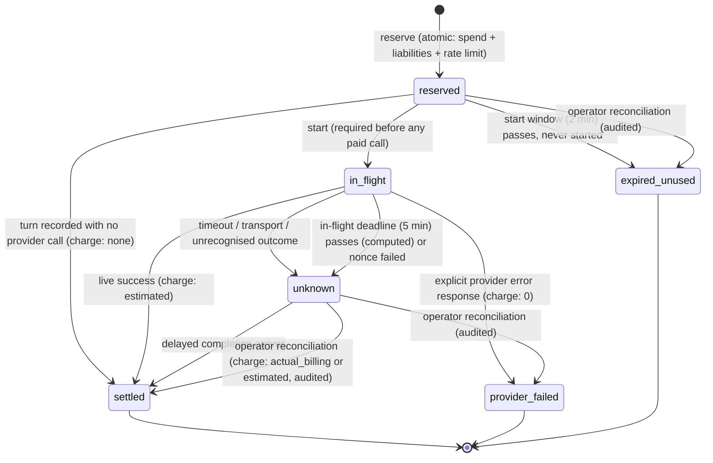

# 12 — Final targeted corrections to PR #1

**Date:** 11 November 2026
**Branch:** `claude/exciting-bardeen-f4y1iz` (draft PR Davg883/Trading-App#1)
**Starting revision:** `ae8f7429babc03efbba1c471f2542012dc1045f7`, verified as the remote head before any change. No later commits existed, so none could be overwritten.
**Independence: NONE.** These corrections were made by the session that wrote the PR. Evidence is V2 (local tests and CI). There is no V3 (production) and no V4 (independent review).

## 0. Inputs and scope

- `docs/investor-due-diligence/14-fable-argon-security-reconciliation.md` is **not available**. It is not on `main`, not on the PR branch (the only two remote branches), and not in the PR comments (the only comment is Vercel's preview bot). The corrections below follow the brief as written; nothing was assumed about that document's contents.
- No Argon Stage 1A branch exists on the remote. Nothing from a competing architecture was merged or introduced. Fable PR #1 remains the only security architecture.
- Not done (not authorised): merge, deploy, repository or branch settings, credentials, brokerage access, trades.

## 1. Findings

| # | Finding | Status | Reference |
|---|---|---|---|
| 1 | `recordAcceptanceTurn` could fail while the route returned HTTP 200 with the answer | **Confirmed.** The brief cites lines 1094–1128; the file has 431 lines, and the defect was at `app/api/graph/chat/route.ts:379-416` of `ae8f742`. Paid signed-in turns had the same gap. | |
| 2 | An expired five-minute reservation stopped counting although its provider call may have been billed | **Confirmed** by a reproduction test (a second paid call was allowed after expiry) | `convex/chatBudget.ts` at `ae8f742` |
| 3 | A Clerk session and an acceptance nonce together: one credential silently ignored | **Confirmed.** The session was used and the nonce ignored (200). | `route.ts` `if (!caller && acceptanceToken)` |
| 4 | Inner evidence JSON only checked to be "a JSON object" | **Confirmed.** `'{}'`, mismatched digests and answers bound to other bundles were accepted. | `lib/graph/chat-turn-audit-validation.ts` |
| 5 | Internal deployment identifiers in public status text | **Confirmed** in `lib/remote-ops/health-monitor.ts`, and also in the homepage's static fallback rows in `lib/portfolio/research-feed.ts` (which additionally claimed "connected", TLS, projection counts and 0 ms lag) | |

No false positives were found. One location in the brief was inaccurate (finding 1's line numbers).

## 2. Commits and changed files

| Commit | Correction | Files |
|---|---|---|
| `c9c274b` | 3 — one credential per request | `app/api/graph/chat/route.ts`; `tests/security-chat-route-credentials.test.ts` (new) |
| `8f382d3` | 2 — durable reservation states | `convex/chatBudget.ts`, `convex/schema.ts`, `convex/acceptanceNonces.ts`, `convex/evidenceChat.ts`, `convex/http.ts`, `lib/graph/evidence-chat-gateway.ts`, `lib/graph/gemini-provider-adapter.ts`, `lib/graph/evidence-chat-contracts.ts`, `lib/graph/chat-turn-audit-validation.ts`, `app/api/graph/chat/route.ts`; tests: `security-chat-budget-reservation` (rewritten), `security-chat-route-fail-closed`, `security-chat-action-budget`, `security-acceptance-nonce`, `security-gateway-field-allowlist` |
| `f892962` | 1 — audit recording fails closed | `app/api/graph/chat/route.ts`; `tests/security-chat-route-audit-fail-closed.test.ts` (new), `tests/security-chat-route-fail-closed.test.ts` |
| `74fd033` | 4 — strict inner evidence validation | `lib/graph/chat-turn-evidence-validation.ts` (new), `lib/graph/chat-turn-audit-validation.ts`, `convex/acceptanceNonces.ts`, `convex/evidenceChat.ts`, `convex/schema.ts`; `tests/helpers/turn-fixture.ts` (new), `tests/security-evidence-validation.test.ts` (new); four suites now use real evidence fixtures |
| `90de0a3` | Minor — deployment identifiers | `lib/remote-ops/health-monitor.ts`, `lib/portfolio/research-feed.ts`; `tests/public-status-identifiers.test.ts` (new) |

## 3. Before/after tests

| Suite | Before (code at the previous commit) | After |
|---|---|---|
| `security-chat-route-credentials` (C3) | 2 of 6 failed: both-credential requests returned 200 | 6 / 6 |
| `security-chat-budget-reservation` + `security-chat-route-audit-fail-closed` (C2, run against `c9c274b`) | 27 of 32 failed | 24 / 24 and 8 / 8 |
| `security-chat-route-audit-fail-closed` (C1, run against `8f382d3`) | 5 of 8 failed: every audit-failure case returned 200 | 8 / 8 |
| `security-evidence-validation` (C4, run against `f892962`) | 15 of 16 failed: every malformed or inconsistent record was accepted | 16 / 16 |
| `public-status-identifiers` (minor) | 3 of 3 failed | 3 / 3 |

**Caveat on the C2 figure.** Some of the 27 failures occur only because the new `start` routes did not exist yet. The cases that show the real defect are:
- the expiry regression (liability vanished after five minutes);
- settlement-outcome classification;
- duplicate completion (no turn-level deduplication);
- start enforcement.

The C1 figure is clean: it was measured against the C2 commit, so only the audit-failure behaviour differed.

Existing tests changed, each to keep its original intent under a stricter protocol, not to weaken a check:
- Fixtures that used `provider_error` as a stand-in for "non-live" now use a no-call status, because a provider error now means a real call that needs a started reservation.
- Live records first start their reservation.
- The registered-function list includes `startAcceptanceBudgetInternal`.
- One route test now expects 503 `audit_record_unconfirmed` instead of 200 `not_recorded` (Correction 1).
- Four suites build evidence from the real deterministic retrieval and answer path instead of `'{}'`.

## 4. Correction 1 — audit recording

| Case | Response | Nonce | Provider |
|---|---|---|---|
| Record confirmed | 200, `auditRecorded` set | `recorded` | called once |
| Audit backend definitively refuses the record | **502** `audit_record_rejected`, answer withheld | failed (`audit_record_rejected`); a started call stays liable as `unknown` | not called again |
| Backend unreachable (timeout, transport, 5xx) after one retry | **503** `audit_record_unconfirmed`, answer withheld | left `consumed` (the record may exist); reported as `abandoned` after its deadline | not called again |
| Transient failure, then retry succeeds | 200 | `recorded` | called once |
| Acceptance budget cannot be started | 503 `budget_unavailable` | failed (`budget_start_failed`); reservation released unused | not called |

- Failure responses report provider and audit outcomes separately:
  - `provider.invoked`, `provider.generationMode`, `provider.providerStatus`;
  - `audit.status`, `audit.reason`.
- The single retry reuses the same `turnId`. Convex deduplicates by owner and turn, so a retry cannot insert twice or charge twice.
- Paid signed-in turns follow the same rule and no longer fall back to the client-credential mutation.
- Non-paid signed-in turns keep their earlier behaviour.

## 5. Correction 2 — budget state model

| State | Liability against the 24-hour ceiling |
|---|---|
| `reserved` (within start window) | `maxCostGbp` (£0.05) |
| `in_flight` (any age) / `unknown` | `maxCostGbp` |
| `settled` with an audit row | counted through the audit row |
| `settled` by reconciliation (no audit row) | the reconciled charge |
| `provider_failed`, `expired_unused` | none |

How each requirement is met:

1. **Expiry never erases liability.** Only a reservation that was never started can lapse.
2. **Unresolved calls stay visible to cost governance.** `in_flight` and `unknown` reservations count against the ceiling and are listed by `listUnresolvedReservationsInternal`.
3. **Settlement is idempotent.** A duplicate record of the same turn returns the original audit ID, and a different turn cannot settle an already-settled reservation.
4. **Retries cannot double-charge or start uncontrolled calls.** Each reservation authorises one provider call, and the provider is never re-called on retry.
5. **An outage cannot bypass the budget.** Without a confirmed reserve and start, no paid call is made.
6. **Budgets cannot lock permanently.** Liability ages out with the 24-hour window, and reconciliation can resolve it sooner.
7. **Charges are distinguished.** Each is labelled `none`, `estimated`, `actual_billing` or `unknown`.
8. **Reconciliation is auditable.** `reconcileReservationInternal` writes an `audit` event, requires an operator and a note, cannot rewrite settled or failed reservations, and is idempotent.
9. **Cross-owner settlement is rejected.** A cross-owner start or settlement looks the same as an unknown reservation.
10. **Tests** cover: a crash after start; timeouts; duplicate completion; delayed completion; never-started expiry; concurrent reservations; the rate limit; outage behaviour; the acceptance paths; and reconciliation.

Provider failures are now classified by the adapter (`providerFailureKind`):
- `error_response`: no charge assumed;
- `timeout_or_transport` or `unknown`: billing unknown, still liable;
- `simulated`: no call was made.

**Provider billing has not been reconciled against invoices.** The `estimated` charges are token usage × the adapter's price table. `actual_billing` exists only for operator entries from billing evidence.

## 6. Correction 3 — credential rule

One credential per request. A request with both a signed-in session and `x-aci-acceptance-nonce` is refused with **400 `ambiguous_credentials`** before either is used. The nonce is not consumed, and no inference or audit write happens. This applies whether or not the session user matches the nonce owner.

No legitimate workflow sends both: acceptance runs are operator tools without a browser session.

## 7. Correction 4 — strict evidence validation

Every new audit write, on all three write paths, now goes through these checks:
- the inner JSON is parsed with the strict Zod schemas;
- the canonical SHA-256 is recomputed with the retrieval gateway's own `computeCanonicalSha256`, and the derived `bundleId` is checked;
- the row's identity fields must match the bundle, the answer and the validation report;
- cited evidence and relationships must be in the bundle when the record is marked valid;
- the bundle's `requesterId` must be the recording owner.

New rows carry `evidenceIntegrity: 'strict_v1'`. **Historical rows are not modified or re-validated.** History and bundle reads label them `legacy_unvalidated`.

## 8. Verification (local, after `90de0a3`)

| Check | Result |
|---|---|
| Vitest | **730 passed, 4 skipped** (3 live TypeDB, 1 billable live evaluation) |
| Python | 218 passed, 1 skipped (live TypeDB) |
| Next.js `tsc` / Convex `tsc -p convex` | pass / pass |
| `next build` | pass |
| actionlint | pass |
| ESLint gate | 29 errors, all pre-existing (one new `any` in a test was caught by the gate and fixed, not baselined) |
| `npm audit --audit-level=high` | pass; 8 moderate advisories remain in dev-only ESLint tooling |
| Owner isolation / graph access / research-only trading | 15/15 · 17/17 · 20/20 |
| GitHub CI | see the PR checks for the pushed head (recorded in the PR description) |

Research-only trading restrictions were not touched; the boundary suite passes unchanged.

## 9. Deployment compatibility

All schema changes are additive and optional, but the `chatBudgetReservations` table is redefined:
- **`chatBudgetReservations` redefined.** It exists only on this unmerged branch, so no production data is affected. If it was ever deployed to a non-production Convex deployment from an earlier revision of this branch, clear that table there before deploying.
- **New audit-row fields:** optional `providerFailureKind` and `evidenceIntegrity` on `evidenceChatAudit`.
- **New nonce field:** optional `budgetReservationSha256` on `acceptanceNonces`.

Version combinations:

| Combination | Effect |
|---|---|
| New Next.js + old Convex | Paid chat returns 503 (`reserve` and `start` routes are missing), so it fails closed. Acceptance consume works only against the new Convex. |
| Old Next.js + new Convex | Old live turns recorded through the client-credential mutation are refused. Old gateway records without a reservation are refused for provider calls. Old records with placeholder evidence fail strict validation, so audit gaps appear until Vercel is updated. |
| Deployment order | Convex first, then Vercel; unchanged and mandatory. `EVIDENCE_CHAT_GATEWAY_SECRET` must be set in both. |

The chat budget now needs two gateway round trips (reserve, start) before a paid call.

## 10. Remaining risks

| Risk | Note |
|---|---|
| Real-backend concurrency | Reserve, start and settle are single Convex mutations, but they were tested only under convex-test's serial model |
| Billing truth | Charges are estimates; no invoice reconciliation exists |
| Unknown liability holds budget for up to 24 hours | Deliberately conservative; operators can reconcile sooner |
| Provider retries inside the adapter | The adapter may try several candidate models on transient errors within one reserved call; the reservation covers the request's estimated maximum, not each attempt |
| Unconfirmed audit (503) | The record may exist; there is no automatic reconciliation of nonces left `consumed` — an operator uses `listNoncesInternal` / `listUnresolvedReservationsInternal` |
| Legacy audit rows | Remain unvalidated by design |
| Earlier open items | H3 (old-route cancel during rollout), H4 (Convex admin key in Next.js), M1–M7 in `11` §2 — unchanged |
| `main` unprotected | The CI gate cannot block a merge (owner setting) |

## 11. Staging verification required (non-production Convex deployment)

1. Ten concurrent `budget/reserve` calls against a low ceiling: no more than the affordable number succeed.
2. Ten concurrent acceptance `consume` calls: exactly one succeeds.
3. Kill the Next.js process after `budget/start`. Confirm the reservation is reported `unknown` after five minutes, still blocks spend, and is resolved by `reconcileReservationInternal` with an audit event.
4. A real Gemini timeout with a short client timeout. Confirm the turn is recorded `provider_error` / `timeout_or_transport` and the reservation stays `unknown`.
5. Compare `estimated` charges for a few live turns with the provider's billing console, and record the result.
6. A real chat round trip records a row with `evidenceIntegrity: 'strict_v1'` (strict validation passes on production-shaped bundles, including live TypeDB-backed ones).
7. Run `npm run test:integration:typedb` against staging TypeDB.

## 12. Pre-merge acceptance status

**APPROVE WITH CONDITIONS — release candidate for a genuinely separate security assessment, not for merge.**

The five targeted corrections are implemented and regression-tested locally. Conditions:
1. Branch protection requiring **CI gate** on `main`.
2. Independent security review of the branch.
3. The staging checks in §11.
4. Production trading flags confirmed off before the Convex deploy.
5. Owner-approved deployment in the order in §9, followed by the post-deployment checks in `03` §7.

This report must not be read as independently verified or production-verified.
