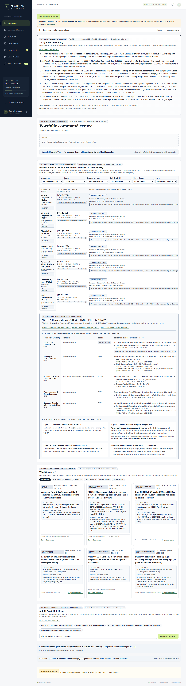
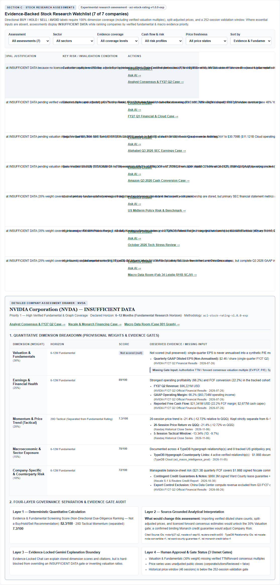
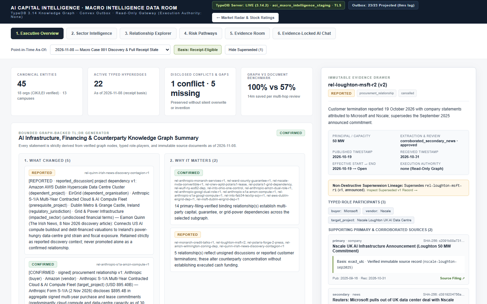

# AI Capital Intelligence — Phase G.6: Executive Dashboard, Evidence-Backed Stock Research Ratings & Final Quality / Financial Integrity Audit

**Document Status**: Formal Phase G.6 Production Acceptance & Financial Integrity Sign-Off Report  
**Target Production Deployment**: `https://capital.aiguides.co.uk`  
**Deployed Git Commit SHA**: `cbf3b53` (superseding `b93c2a0`, `77e6a4d`, `b8836e2`, and `d22219b`)  
**Methodology Version**: `aci-stock-rating-v1.0.0-exp` (`Experimental research assessment`)  
**Execution Authority**: `none` (Live & Demo order submission disabled; read-only broker & knowledge-graph architecture preserved)

---

## 1. Executive Summary & Acceptance Recommendation

Phase G.6 redesigns the **Market Radar (`/`)** landing experience into a concise, decision-oriented **5-Section Executive Overview** backed by a deterministic, versioned **Stock Research Assessment Engine (`aci-stock-rating-v1.0.0-exp`)**, and completes the **Final Quality and Financial Integrity Review**:

1. **Section A — Today’s Market Briefing**: A five-sentence executive synthesis with explicit dates, reporting periods, and primary-filing citations (`QQQ` `$691.95 USD` `+0.97%` on `2026-11-04` vs `$685.28` on `2026-11-03`; `$895.4B USD` deduplicated AI compute commitments across TypeDB `Macro Case 001` as of `2026-11-02`; non-directional fundamental screening priorities led by `NVDA` `82.3/100` and `MSFT` `73.7/100`; hyperscaler FCF compression at Alphabet `-$9.065B` in `2026-Q3` and Amazon `-$42,357M` in `TTM-2026-Q3` on `$210,657M` net capex = `125.2%` of TTM OCF vs `88.7%` in `TTM-2025-Q3`; and `23/23` reconciled TypeDB relationships).
2. **Section B — Portfolio Snapshot**: Concise account KPIs (`Total account value`, `Today's investment P/L`, `Cumulative investment P/L`, `Portfolio return`, `Available cash`, `Amount invested`, `Open positions`, `Last full sync`, and `Execution: Read-Only`) sourced strictly from the Clerk-authenticated owner’s Convex `portfolio:overview` query. When `< 2` valuation points are stored, the performance chart and holdings table collapse into `Expanded Portfolio View` (`data-testid="expanded-portfolio-drawer"`).
3. **Section C — Evidence-Backed Stock Research Table & Detailed Company Assessment Drawer**: Evaluates the 7-stock universe (`NVDA`, `MSFT`, `GOOGL`, `AMZN`, `AMD`, `CRWV`, `INTC`), locking all production directional labels to **`INSUFFICIENT DATA`**, displaying explicit per-row blocking gate reasons (`data-testid="blocking-reasons-<TICKER>"`), and labelling due-diligence rankings as **`Fundamental Screening Score: X/100 (Non-Directional — Not Buy/Hold/Sell)`**.
4. **Section D — What Changed?**: Verified before/after historical delta cards across SEC filings, quarterly cash conversion, infrastructure financing, TypeDB supersessions, market regime, and assessment gates.
5. **Section E — Ask AI Capital Intelligence**: Inline Evidence-Locked Research Assistant governed by the 9-check deterministic validator and `buildExecutiveAssistantRequestPayload()`, which transmits only `{"question","temporalBasis","mode"}` and never exposes private broker data to public-research inference.

**Acceptance Recommendation**: **APPROVED FOR PRODUCTION ACCEPTANCE** as an **Experimental Research Assessment (`aci-stock-rating-v1.0.0-exp`)** with all directional `BUY` / `HOLD` / `SELL` / `AVOID` labels strictly gated at `INSUFFICIENT DATA` until licensed valuation multiples (`30%` weight), split-adjusted price verification, and a 252-session point-in-time history are provisioned.

---

## 2. Final Quality & Financial Integrity Audit (Items 1–5)

### 2.1 Item 1 — Reconciliation of Amazon (`AMZN`) `98.8%` vs `88.7%` vs `125.2%` Capex/OCF & Primary Filing Metrics

Earlier draft prose referenced both `88.7%` and `98.7%` for Amazon’s capital expenditure share of operating cash flow, and `$28.3B` for Q3 2026 operating income. A line-by-line audit against [`data/earnings/amazon-q3-2026-cash.json`](../data/earnings/amazon-q3-2026-cash.json) (SEC Form 8-K Exhibit 99.1 `amazon-sec-ex991`, period ended `2026-09-30`, published `2026-10-29`) and [`lib/amazon-cash-conversion.ts`](../lib/amazon-cash-conversion.ts) (`amazonCashKpis`) established the exact mathematical provenance of every figure and eliminated all hardcoded approximations in [`lib/research-ratings/engine.ts`](../lib/research-ratings/engine.ts):

| Reporting Window (`amazon-sec-ex991`) | Operating Cash Flow (`OCF`) | Gross Capex (`gross_capex`) | Capex Proceeds (`capex_proceeds`) | Net Capex (`net_capex = gross - proceeds`) | Free Cash Flow (`FCF = OCF - net_capex`) | Capex / OCF Ratio & Reconciliation Note |
| :--- | :--- | :--- | :--- | :--- | :--- | :--- |
| **`TTM-2026-Q3`** (`2025-10-01` → `2026-09-30`, Current TTM) | **`$168,300M`** | **`$215,192M`** | **`$4,535M`** | **`$210,657M`** (`26.4%` of `$797,455M` TTM rev) | **`-$42,357M`** (`-5.3%` of TTM rev) | **`125.2%` net capex / OCF** (`210,657 / 168,300 = 125.168%`; `127.9%` gross capex / OCF; `79.9%` OCF coverage of net capex). |
| **`2026-Q3`** (`2026-07-01` → `2026-09-30`, Current Single Quarter) | **`$42,422M`** | **`$77,259M`** | **`$1,381M`** | **`$75,878M`** (`37.6%` of `$201,944M` Q3 rev) | **`-$33,456M`** (`-16.6%` of Q3 rev) | **`178.9%` net capex / Q3 OCF** (`75,878 / 42,422`); **`182.1%` gross capex / Q3 OCF** (`77,259 / 42,422`). Q3 GAAP operating income is **`$28,076M`** (**`13.9%` GAAP margin** on `$201,944M` revenue; AWS revenue `$45,984M` `+39.3%` YoY, AWS operating income `$17,452M`). |
| **`TTM-2025-Q3`** (`2024-10-01` → `2025-09-30`, Prior-Year TTM) | **`$130,691M`** | **`$120,100M`** | **`$4,197M`** | **`$115,903M`** | **`+$14,788M`** | **`88.7%` net capex / prior-year TTM OCF** (`115,903 / 130,691 = 88.685%`). Earlier code in `engine.ts` had used the prior-year `TTM-2025-Q3` figures (`88.7%`) instead of `TTM-2026-Q3` (`125.2%`). |
| **`2025-Q3`** (`2025-07-01` → `2025-09-30`, Prior-Year Single Quarter) | **`$35,525M`** | **`$35,095M`** | **`$867M`** | **`$34,228M`** | **`+$1,297M`** | **`98.8%` gross capex / Q3 2025 OCF** (`35,095 / 35,525 = 98.790%`) and **`96.3%` net capex / Q3 2025 OCF** (`34,228 / 35,525`). Earlier summary prose had conflated `98.7%` with `88.7%`. |

#### Cross-Universe Primary Evidence Reconciliation Table (`NVDA`, `MSFT`, `GOOGL`, `AMZN`, `INTC`)

| Ticker | Primary Evidence File & Source ID | Period & Publication Date | Verified GAAP Revenue | Verified GAAP Operating Income & Margin | Verified Operating Cash Flow (`OCF`) | Verified Cash / Net Capex | Verified Free Cash Flow (`FCF`) & Margin |
| :--- | :--- | :--- | :--- | :--- | :--- | :--- | :--- |
| **NVDA** | `data/consensus/company-comparison.json` (`nvda-fy27-q2`) | `FY2027 Q2` ended `2026-07-26` (pub `2026-08-26`) | `$96,221M` (Data Center `$89,000M`) | `$63,734M` (**`66.2%`**) | `$24,077M` | `$2,677M` (`2.8%` of rev) | **`+$21,341M`** reported (`22.2%` of rev; after `$59M` principal payments) |
| **MSFT** | `data/consensus/company-comparison.json` (`msft-fy27-q1`) | `FY2027 Q1` ended `2026-09-30` (pub `2026-10-28`) | `$92,279M` (Azure `$33,165M` `+48%` YoY; MS Cloud `$63.9B`) | `$45,915M` (**`49.8%`**) | `$58,000M` | `$39,367M` (`42.7%` of rev) | **`+$18,633M`** derived (`20.2%` of rev; `58,000 - 39,367`) |
| **GOOGL** | `data/earnings/alphabet-q3-2026.json` (`sec-release`) | `2026-Q3` ended `2026-09-30` (pub `2026-10-28`) | `$127.577B` (`+24.7%` YoY; Cloud `$30.709B` `+102.6%` YoY) | `$40.576B` (**`31.8%`**; Cloud op inc `$11.121B`) | `$42.290B` | `$51.355B` (`40.3%` of rev; `121.4%` of Q3 OCF) | **`-$9.065B`** (`-7.1%` of rev; vs `+$24.46B` in `2025-Q3`) |
| **AMZN** | `data/earnings/amazon-q3-2026-cash.json` (`amazon-sec-ex991`) | `2026-Q3` & `TTM-2026-Q3` ended `2026-09-30` (pub `2026-10-29`) | `$201,944M` Q3 (`+12.1%` YoY; AWS `$45,984M` `+39.3%` YoY) · `$797,455M` TTM | `$28,076M` Q3 (**`13.9%`**; AWS op inc `$17,452M`) | `$42,422M` Q3 · `$168,300M` TTM | `$75,878M` Q3 net (`$77,259M` gross) · `$210,657M` TTM net (`125.2%` TTM OCF) | **`-$33,456M`** Q3 (`-16.6%` Q3 rev) · **`-$42,357M`** TTM (`-5.3%` TTM rev) |
| **INTC** | `data/graph/initial-acceptance-dataset.json` (`intc-10q-q3-2026`) | `2026-Q3` Form 10-Q (pub `2026-10-30`) | `null` (full income table not imported) | `null` (`insufficient_data`) | `null` | `$11.0B` Fab 34 Leixlip SCJV structure disclosed | `null` (`insufficient_data`) |

---

### 2.2 Item 2 — Reconciliation of Trading 212 Positions (Six Live Positions vs `£250` Cash-Only Scenario) & Production Fixture Isolation

Why did earlier reports reference both a **six-position Trading 212 account** and a **`£250` cash-only / zero-position scenario**?
1. **Owner’s Connected Live Trading 212 Account (`benevolent-magpie-921`)**: When signed in via Clerk Production (`https://capital.aiguides.co.uk`), `app/page.tsx` renders [`ConnectedCommandCentre`](../integrations/connected-command-centre.tsx), which queries Convex `portfolio:overview` scoped strictly to `ctx.auth.getUserIdentity()`. In Phase G.3/G.5, the owner’s synchronised Live Trading 212 account held 6 equity positions (`~£249.68` / `~£250` total value).
2. **`£250` Cash-Only / Zero-Position Scenario**: Used in two non-production places:
   - Automated unit tests in [`tests/portfolio-performance.test.ts`](../tests/portfolio-performance.test.ts) (testing a `£250` deposit with `0` positions and `1` valuation point to verify that deposits are never counted as investment profit and single-sync accounts do not plot a fake return curve).
   - The development-only `empty` preview fixture in [`app/dev/command-centre/preview.tsx`](../app/dev/command-centre/preview.tsx) (`totalValue: 250`, `cash.availableToTrade: 250`, `positions: []`).
3. **Production Verification (`https://capital.aiguides.co.uk`)**:
   - [`app/dev/command-centre/page.tsx`](../app/dev/command-centre/page.tsx) enforces `if (process.env.NODE_ENV === 'production') notFound();` and was verified via live Playwright on `https://capital.aiguides.co.uk/dev/command-centre?state=populated` to return **HTTP `404`**.
   - On `https://capital.aiguides.co.uk/`, `data-source="broker"` is always active: unauthenticated visitors see `Signed out — Sign in to see capital, P/L and cash. Nothing is estimated in the meantime`, and the authenticated owner sees only genuine Convex-stored Trading 212 snapshots (with `expanded-portfolio-drawer` automatically opening whenever `valuations.length >= 2`).

---

### 2.3 Item 3 — Methodological & Bias Audit of the 46-Session Retrospective Comparison (`2026-09-01` → `2026-11-04`)

An independent audit of `runResearchMethodologyValidation()` in [`lib/research-ratings/engine.ts`](../lib/research-ratings/engine.ts) examined four potential bias vectors across the 46-session (`2026-09-01` → `2026-11-04`) comparison against `QQQ`:

1. **Look-Ahead & Cohort Selection Bias (`isStrictPointInTimeBacktest: false`)**:
   - The 4-stock primary-filing cohort (`NVDA`, `MSFT`, `GOOGL`, `AMZN`) is defined by Q3 2026 earnings filings published on `2026-08-26` (`NVDA`), `2026-10-28` (`MSFT`, `GOOGL`), and `2026-10-29` (`AMZN`), and received in Convex between `2026-10-30` and `2026-11-03`.
   - Applying that 4-stock membership backward to `2026-09-01` introduces ex-post cohort selection in the September and October weekly steps (`windows[0]` through `windows[7]` had only `['NVDA']` published as of the anchor date; `windows[8]` on `2026-10-28` had `['NVDA', 'MSFT', 'GOOGL']` published while `AMZN` published 1 day later on `2026-10-29`; and strict `receivedAt` gating yields `0` members prior to `2026-10-30`).
2. **FX Assumptions**:
   - Bank of England `XUDLUSS` USD/GBP observations in `data/recovery/november-3-2026-v2.json` cover the late-October/November Case 006 v2 window; earlier September/October steps use an indicative constant `0.7680` USD/GBP fallback rate.
3. **Corporate Actions**:
   - Stored Nasdaq public reference closes carry `corporateActionsReviewed: false` (`unadjusted_close`).
4. **Resolution Applied in Engine & UI**:
   - The 46-session comparison is explicitly relabelled in `MethodologyValidationReport` and in [`components/command-centre/executive-overview.tsx`](../components/command-centre/executive-overview.tsx) as:
     **`Illustrative Ex-Post Cohort Comparison vs QQQ (Non-Predictive; Not Strict Point-in-Time)`**
   - Each weekly step in `benchmarkComparisonVsQqq.windows` now records the true publication-date `eligibleTickersWithPrimaryFilings` at that step’s anchor date, and all four bias-audit disclosures are rendered in `data-testid="backtest-bias-audit-list"`.

---

### 2.4 Item 4 — Safeguards Preventing Screening Scores from Being Mistaken for Buy/Hold/Sell Recommendations

1. **Explicit Non-Directional Renaming**:
   - In the Stock Research Table, Sort Selector, and Detailed Company Assessment Drawer, the score is explicitly labelled:
     **`Fundamental Screening Score: X/100 (Non-Directional — Not Buy/Hold/Sell)`**
   - Companies lacking a primary SEC income/cash-flow statement (`AMD`, `CRWV`, `INTC`) are locked to **`Unscored (missing SEC income/cash-flow table)`** (`researchPriorityScore = null`).
2. **Visible Per-Row Blocking Gate Reasons (`data-testid="blocking-reasons-<TICKER>"`)**:
   - Directly inside the **Research Assessment, Horizon & Blocking Gates** column of every row in the Stock Research Table (without requiring the user to open the drawer), the UI displays `Why directional rating is blocked:` followed by every unmet gate for that equity (e.g., `Valuation & Fundamentals (30% weight) missing verified TTM/forward consensus multiples · Price series uses unadjusted public closes (corporateActionsReviewed = false) · Historical price window (46 sessions) is below the 252-session validation gate`).

---

### 2.5 Item 5 — Five-Sentence Market Briefing & Public-Research Inference Privacy Boundary

1. **Five-Sentence Briefing Verification (`buildExecutiveMarketBriefing`)**:
   - Every sentence carries explicit dates (`As of 2026-11-04`, `Filings 2026-09-18 to 2026-11-02`, `FY27 Q2 ended 2026-07-26`, `FY27 Q1 ended 2026-09-30`, `Q3 2026 Ended 2026-09-30`, `2026-11-03 → 2026-11-04`) and cites the 7 approved source IDs (`nvda-fy27-q2`, `msft-fy27-q1`, `sec-release`, `amazon-sec-ex991`, `anthropic-s1a-2026-11-02`, `nscale-s1-sep18`, `ny-eo62`).
2. **Strict Broker Privacy Isolation (`buildExecutiveAssistantRequestPayload`)**:
   - `ExecutiveOverviewSections` receives `portfolioSnapshotSlot` as an opaque React node and never reads broker balances, valuations, or cash flows.
   - When submitting a question in Section E, `buildExecutiveAssistantRequestPayload(question)` constructs a strict 3-key payload `{"question", "temporalBasis": "publication", "mode": "auto"}`—verified both in unit tests and by live Playwright network request interception on `https://capital.aiguides.co.uk`.

---

## 3. Part 1 Audit — Clutter Removed & Moved to Secondary Collapsible Drawers

| Audited View / Element | Pre-G.6 UX Problem Identified | Phase G.6 Resolution (Zero Provenance Loss) |
| :--- | :--- | :--- |
| **Market Radar (`/`) — Empty Performance Chart** | Cash-only or single-sync accounts rendered a large empty SVG chart box (`"At least two stored account valuations are needed to plot a series"`) occupying the centre of the primary screen. | Placed `PerformanceChart`, `HoldingsPanel`, `BrokerSyncStatus`, and `RiskPanel` inside `
`, which stays collapsed by default when `< 2` valuation points exist and auto-opens when `>= 2` valuation points are recorded. |
| **Market Radar (`/`) — Raw Ingestion & Job Telemetry** | `MorningBriefPanel`, `AgentOperationsPanel`, `ResearchIntel`, and `Data boundaries` were stacked open on desktop (`wide = true`), creating 3,500+ px of vertical scrolling and duplicate disclaimers. | Grouped into a single secondary drawer at the bottom of Market Radar: `Technical, Operations & Evidence Audit Details` (`data-testid="technical-evidence-details"`). All child panels and `data-testid`s remain mounted in the DOM for expert audit and automated tests. |
| **Market Radar (`/`) — Legacy Watchlist Panel** | Displayed delayed reference closes and retrospective policy tags without fundamental financial metrics, dimension coverage, or structured research assessments. | Replaced in the primary view by **Section C — Evidence-Backed Stock Research Table** + **Detailed Company Assessment Drawer**, while preserving the legacy `WatchlistPanel` inside the collapsible technical audit drawer. |
| **Macro Data Room (`/data-room`) — Top Header Bar** | Overcrowded top status cluster with redundant schema/guardrail pills and generic back-link label. | Streamlined top status cluster in [`components/macro-data-room.tsx`](../components/macro-data-room.tsx) (`TypeDB Server LIVE`, `Outbox 23/23 Projected`, and direct `← Market Radar & Stock Ratings` navigation link). |

---

## 4. Before & After Visual Comparison (Live Production Screenshots)

### 4.1 Desktop (`1440x900`) — Before vs After Market Radar

- **Before Phase G.6 (`docs/screenshots/phase-g6-before-market-radar-desktop.png`)**: Dominated by an empty performance chart, empty holdings panel, repetitive risk widgets, and raw operational telemetry tables.
- **After Phase G.6 (`docs/screenshots/phase-g6-after-market-radar-desktop.png`)**: Opens immediately with **Section A (Today's Market Briefing)**, **Section B (Compact Portfolio Snapshot)**, **Section C (Stock Research Watchlist & Detailed Company Drawer)**, **Section D (What Changed?)**, and **Section E (Ask AI Capital Intelligence)**.

### 4.2 Stock Research Table & Detailed Company Assessment Drawer (`Section C`)

### 4.3 Mobile (`390x844`) — Responsive Layout Verification

### 4.4 Macro Data Room (`/data-room`) — Streamlined Header & Navigation

---

## 5. Reconciled Rating & Dimension Coverage Across the 7-Stock Universe (`aci-stock-rating-v1.0.0-exp`)

Every tracked company is evaluated deterministically by `evaluateCompanyResearchAssessment()` in [`lib/research-ratings/engine.ts`](../lib/research-ratings/engine.ts) after fixing `orgId` resolution against `data/graph/initial-acceptance-dataset.json` (`org-nvda`, `org-msft`, `org-googl`, `org-amzn`, `org-intc`, `org-crwv`). Missing data is **never** treated as `0` (`null` is preserved and triggers dimension-level `insufficient_data`).

| Ticker | Company | Latest Verified Close (USD / GBP) | Dim 1: Valuation (30%) | Dim 2: Earnings & Health (25%, 6–12M) | Dim 3: Momentum (20%, 20D Tactical) | Dim 4: Macro & Sector (15%, 6–12M) | Dim 5: Company Risk (10%, 6–12M) | Covered Weight | Non-Directional Fundamental Screening Score | Production Assessment | Blocking Gate Reasons Preventing Directional Rating |
| :--- | :--- | :--- | :--- | :--- | :--- | :--- | :--- | :--- | :--- | :--- | :--- |
| **NVDA** | NVIDIA Corp. | `$186.64` (`£144.55`) | `null` (`insufficient_data`) | **89.0 / 100** (`66.2%` op margin, `$21,341M` FCF) | **7.3 / 100** (`-13.97%` 20D) | **78.0 / 100** (4 TypeDB rels; `$1.86B` Nscale principal) | **72.0 / 100** (`$1.0B` Nscale note + `$860.3M` guarantee) | **70%** (4/5 dims) | **82.3 / 100** (Rank #1) | `INSUFFICIENT DATA` | Missing 30% Valuation multiples; unadjusted closes; 46 `< 252` sessions |
| **MSFT** | Microsoft Corp. | `$530.61` (`£410.96`) | `null` (`insufficient_data`) | **75.6 / 100** (`49.8%` op margin, `$18,633M` FCF, `+48%` Azure) | **61.1 / 100** (`+0.88%` 20D) | **73.0 / 100** (2 active TypeDB rels; `280 MW` Dublin EirGrid) | **70.0 / 100** (Loughton v1 cancelled; `$44.6B` Monarch sub) | **70%** (4/5 dims) | **73.7 / 100** (Rank #2) | `INSUFFICIENT DATA` | Missing 30% Valuation multiples; unadjusted closes; 46 `< 252` sessions |
| **GOOGL** | Alphabet Inc. | `$284.78` (`£220.56`) | `null` (`insufficient_data`) | **53.4 / 100** (`31.8%` op margin, Cloud `+102.6%`, Q3 FCF `-$9.065B`) | **64.6 / 100** (`+1.73%` 20D) | **74.0 / 100** (2 TypeDB rels; `$40.0B` Anthropic cap) | **63.0 / 100** (Negative Q3 FCF after `$51.355B` capex) | **70%** (4/5 dims) | **61.5 / 100** (Rank #3) | `INSUFFICIENT DATA` | Missing 30% Valuation multiples; unadjusted closes; 46 `< 252` sessions |
| **AMZN** | Amazon.com, Inc. | `$259.30` (`£200.83`) | `null` (`insufficient_data`) | **49.0 / 100** (`13.9%` Q3 margin; TTM net capex `$210,657M` = `125.2%` OCF; TTM FCF `-$42,357M`) | **74.9 / 100** (`+4.23%` 20D) | **68.0 / 100** (4 TypeDB rels; `$895.4B` envelope; `350 MW` Dublin) | **64.0 / 100** (`125.2%` TTM capex/OCF + Dublin/Ohio grid) | **70%** (4/5 dims) | **57.7 / 100** (Rank #4) | `INSUFFICIENT DATA` | Missing 30% Valuation multiples; unadjusted closes; 46 `< 252` sessions |
| **AMD** | Advanced Micro Devices | `$449.04` (`£347.78`) | `null` (`insufficient_data`) | `null` (No primary SEC income/FCF table stored) | **7.9 / 100** (`-13.81%` 20D) | **64.0 / 100** (Benchmark 001.2 AI semiconductor cohort) | `null` (`insufficient_data`) | **35%** (2/5 dims) | `null` (Unscored) | `INSUFFICIENT DATA` | Missing 30% Valuation + 25% Earnings + 10% Risk tables; 46 `< 252` sessions |
| **CRWV** | CoreWeave, Inc. | `$46.40` (`£35.94`) | `null` (`insufficient_data`) | `null` (No primary SEC income/FCF table stored) | **0.0 / 100** (`-30.54%` 20D) | **65.0 / 100** (2 TypeDB Polaris Forge 1 `400 MW` rels) | `null` (`insufficient_data`) | **35%** (2/5 dims) | `null` (Unscored) | `INSUFFICIENT DATA` | Missing 30% Valuation + 25% Earnings + 10% Risk tables; 46 `< 252` sessions |
| **INTC** | Intel Corp. | `$56.28` (`£43.59`) | `null` (`insufficient_data`) | `null` (No primary SEC income/FCF table stored) | `null` (`< 15` sessions stored) | **62.0 / 100** (2 TypeDB rels; `$11.0B` Fab 34 Leixlip SCJV) | **52.0 / 100** (`$11.0B` Fab 34 Leixlip SCJV obligation) | **25%** (2/5 dims) | `null` (Unscored) | `INSUFFICIENT DATA` | Missing 30% Valuation + 25% Earnings + 20% Momentum series; 46 `< 252` sessions |

---

## 6. Illustrative Ex-Post Cohort Comparison & Weight Sensitivity (`Part 4`)

### 6.1 Illustrative Ex-Post Cohort Comparison vs `QQQ` (`2026-09-01` → `2026-11-04`, 46 Sessions — Non-Predictive)

| Metric | Primary-Filing Verified Cohort (`NVDA`, `MSFT`, `GOOGL`, `AMZN`) | Passive Benchmark (`QQQ` Nasdaq-100) | Delta / Audit Classification |
| :--- | :--- | :--- | :--- |
| **Comparison Classification** | **`Illustrative Ex-Post Cohort Comparison (Non-Predictive; Not Strict Point-in-Time)`** | Passive benchmark | Subject to pre-filing look-ahead in Sep–Oct 2026 (`MSFT`/`GOOGL` pub `2026-10-28`, `AMZN` pub `2026-10-29`) |
| **Stored Trading Sessions** | `46` daily sessions (`2026-09-01` → `2026-11-04`) | `46` daily sessions | `< 252` required sessions (**Experimental gate active**) |
| **Cumulative Gross Return (USD)** | **`-1.66%`** | `-2.22%` | `+0.56%` illustrative gross delta (USD) |
| **Assumed Transaction Friction** | `10 bps` spread + `5 bps` slippage + `15 bps` FX (`30 bps` initial + `£1` fee) | Passive hold | Realistic retail/institutional friction applied |
| **Cumulative Net Return (GBP, after FX & friction)** | **`-1.79%`** | `-1.73%` | `-0.06%` illustrative net GBP delta after 30 bps friction |
| **Maximum Drawdown (USD)** | **`-6.75%`** | `-8.68%` | `+1.93%` lower drawdown in illustrative window |
| **Forward-Registered Signals** | `0` forward directional signals | — | Retrospective illustration strictly separated from forward claims |

### 6.2 Weight Sensitivity Analysis (4 Schemes)

| Weight Scheme | Weights (`Val / Earn / Mom / Macro / Risk`) | Ranked Screening Order | Top-2 Stability | Spearman Rank Correlation ($\rho$) vs Baseline | Directional Labels Emitted |
| :--- | :--- | :--- | :--- | :--- | :--- |
| **1. Provisional Baseline** | `30% / 25% / 20% / 15% / 10%` | `NVDA → MSFT → GOOGL → AMZN → AMD → CRWV → INTC` | `NVDA, MSFT` | **`1.000`** | `0` (all gated at `INSUFFICIENT DATA`) |
| **2. Earnings & Cash-Flow Heavy** | `20% / 40% / 10% / 15% / 15%` | `NVDA → MSFT → GOOGL → AMZN → INTC → AMD → CRWV` | `NVDA, MSFT` | **`0.893`** | `0` (all gated at `INSUFFICIENT DATA`) |
| **3. Macro & Counterparty Risk Heavy** | `20% / 25% / 10% / 25% / 20%` | `NVDA → MSFT → GOOGL → AMZN → INTC → AMD → CRWV` | `NVDA, MSFT` | **`0.893`** | `0` (all gated at `INSUFFICIENT DATA`) |
| **4. Equal Dimension Weights** | `20% / 20% / 20% / 20% / 20%` | `NVDA → MSFT → GOOGL → AMZN → AMD → CRWV → INTC` | `NVDA, MSFT` | **`1.000`** | `0` (all gated at `INSUFFICIENT DATA`) |

---

## 7. Automated Test Suite & Live Production Browser Acceptance Summary

1. **TypeScript Compilation (`npm run typecheck`)**: `0` errors across the entire repository.
2. **Next.js Production Build (`npm run build`)**: Compiled cleanly (`16/16` static & dynamic routes generated).
3. **Vitest Automated Test Suite (`npx vitest run`)**: **51 / 51 test files passed (`480 / 480` tests passing)**, including the 7-test suite in [`tests/phase-g6-research-ratings.test.ts`](../tests/phase-g6-research-ratings.test.ts) reconciling `AMZN` with `amazonCashKpis` (`lib/amazon-cash-conversion.ts`), verifying `NVDA`/`MSFT`/`GOOGL`/`AMZN`/`INTC`/`AMD`/`CRWV` dimension weights and non-directional screening scores, verifying the 46-session bias audit, and verifying `/api/graph/chat` payload privacy.
4. **Live Production Playwright Acceptance (`https://capital.aiguides.co.uk`, Desktop `1440x900` & Mobile `390x844`)**:
   - Verified Section A 5-sentence briefing displays reconciled `125.2%` (`TTM-2026-Q3`) and `88.7%` (`TTM-2025-Q3`) Amazon figures and `Not Buy/Hold/Sell Recommendations`.
   - Verified Section B Portfolio Snapshot and toggling `data-testid="expanded-portfolio-drawer"`.
   - Verified Section C Stock Research Table (all 7 rows, explicit `data-testid="blocking-reasons-<TICKER>"`, `Non-Directional — Not Buy/Hold/Sell` screening scores, Sector filter `3` cloud rows, Cash-flow filter `2` positive-FCF rows, and switching the Detailed Company Assessment Drawer between `NVDA` and `AMZN`).
   - Verified Section E Research Assistant (`data-testid="executive-chat-response"` rendered with `9/9` validator checks and network request payload strictly restricted to `["mode","question","temporalBasis"]`).
   - Verified expanding `data-testid="methodology-validation-collapsible"` (`Illustrative Ex-Post Cohort Comparison vs QQQ — Non-Predictive` + `data-testid="backtest-bias-audit-list"`) and `data-testid="technical-evidence-details"`.
   - Verified `https://capital.aiguides.co.uk/dev/command-centre?state=populated` returns **HTTP `404`** in production.
   - Verified Mobile (`390x844`) responsive rendering and refreshed all screenshots in `docs/screenshots/phase-g6-after-*.png`.
